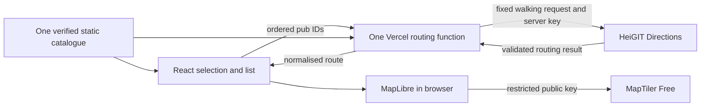

# Architecture decisions

Latest decisions: the accepted [Task 2 design research](#milestone-2-task-2--provider-architecture-and-security-design--19-october-2026) is supplemented by the [5 November live-proof decision](#milestone-2-live-proof-preparation--5-november-2026). The owner approved proportionate free-plan safeguards without metered WAF and sourced building waypoints without surveyed doors. Actual account/configuration checks and separately approved live testing/publication remain required. Earlier accepted records below are preserved as history.

Updated 19 October 2026 following owner acceptance of Milestone 2, Task 1 research. [Product brief](product-brief.md) owns scope and behavioural contracts, [backlog](backlog.md) sequences delivery, and [progress](progress.md) records evidence. An architectural decision does not itself authorise accounts, credentials, deployment, commits or a feature task.

Current research: [Milestone 2 provider verification, 19 October 2026](#milestone-2-task-1--provider-verification--19-october-2026). This supplements the historical records below; it does not accept Milestone 2 or authorise implementation.

## Accepted — canonical repository

The owner selected `/Users/rickybyrne/Documents/ChatGPT/baubled` and `https://github.com/rickybyrne/Baubled.git`. The React/Vite foundation is already committed and pushed: `0293e6da409815bc894c98fad5c0f676b2037e7e` (`feat: initialise Baubled application foundation`, 16 October 2026) was both local HEAD and live remote `main` during the 16 October verification. Its [hosted Validate run](https://github.com/rickybyrne/Baubled/actions/runs/38926238221) passed.

Do not recreate the initial commit, configure another remote, import the obsolete Next.js project/history, or reconcile its instructions. The owner's repository update supersedes the earlier empty-repository assumption. The obsolete directory remains untouched. The 16 October planning reconciliation did not authorise a commit or push. On 17 October, the owner explicitly authorised publishing the six planning Markdown files with commit subject `docs: establish Baubled product plan`; this does not authorise deployment or another milestone.

## Accepted — application architecture

Retain React/Vite, strict TypeScript, Tailwind's Vite integration, npm with one lockfile, ESLint, Vitest/React Testing Library, and GitHub Actions. The current single root page uses native fragment navigation and system/Georgia fonts; it needs no router, state library, provider or external font service. Theme tokens live in `src/styles.css`. Keep decoration subtle and respect reduced motion; the existing page has no animation or smooth scrolling.

React/Vite fits an interactive browser application with static data and URL sharing. A framework migration is not justified by CV value. Future editing will use pure operations and `useReducer`, separating ordered IDs, results for that exact order, and interface state; Context only where useful. Contain map-specific logic and normalise routing responses through one small module. This permits later provider migration without designing a generic provider framework now.

A backend is not the default. If credential policy or another concrete requirement demands a small serverless endpoint, propose its validation, rate limits and operating constraints before approval. A proxy alone neither guarantees quota protection nor controls separately metered map usage. Frontend environment variables are public. No persisted provider-response cache is assumed until storage terms are checked.

## Implemented tooling and historical selection rationale

Current manifests pin Node 24.19.0 (`.nvmrc`), npm 12.2.0, React/DOM 19.3.1, Vite 8.3.4, Tailwind 4.3.3, TypeScript 6.0.3, ESLint 10.12.0, Vitest 5.0.4 and React Testing Library 16.3.3. Full versions live in `package.json` and `package-lock.json`; this planning task does not update them. CI uses `.nvmrc` and matching npm; the production build includes TypeScript checking.

The 14 October foundation notes report verification against official npm metadata and selection of TypeScript 6.0.3 because typescript-eslint 8.71.2 supported `>=4.8.4 <6.1.0`, excluding the then-reported latest TypeScript 7.0.2. These selection claims are historical, not a fresh latest-version/compatibility survey in this task. Existing setup references:

- [Vite](https://vite.dev/guide/) and [Tailwind's Vite integration](https://tailwindcss.com/docs/installation/using-vite).
- [Vitest](https://vitest.dev/guide/) and [React Testing Library](https://testing-library.com/docs/react-testing-library/setup/).
- [Node release lifecycle](https://nodejs.org/en/about/previous-releases) and [official npm metadata](https://registry.npmjs.org/).

Tests currently establish markup/destination contracts, not browser focus, layout, venue accuracy or live integration. Add a small Playwright suite later for meaningful journeys, keeping routine provider tests deterministic and separate from approved live smoke checks.

## Accepted — cost boundary; provisional — services

The operating budget is strictly **€0/month**. The owner accepts temporary feature unavailability at enforced limits. Free allowances, notifications, client-side counters and request cancellation do not guarantee protection from charges. Any future paid migration requires an explicit owner-approved change to this constraint.

The following is **owner-supplied historical research dated 14 October 2026**, not newly verified provider policy in this documentation task. Listing a candidate does not approve a production integration.

| Candidate | Historical rationale | Official starting points |
| --- | --- | --- |
| MapLibre GL JS | Intended open-source map renderer replacing Mapbox GL JS. Rendering is separate from tile-service usage policy. | [MapLibre](https://maplibre.org/projects/gl-js/), [React integration](https://visgl.github.io/react-map-gl/docs/get-started) |
| MapTiler Free | Reportedly pauses at quota and permits personal/non-commercial use without billing information. Earlier research listed 100,000 API requests/month and 5,000 SDK sessions/month; these are different measures, not interchangeable visitor allowances. It also listed one API key, so separate dev/prod keys cannot be assumed. | [Pricing](https://www.maptiler.com/cloud/pricing/), [terms](https://www.maptiler.com/terms/cloud/), [key/origin guidance](https://docs.maptiler.com/guides/credentials/api-key/) |
| openrouteservice Standard | Reportedly €0 with 2,000 Directions requests/day and 40/minute, errors/blocking at limits, and 50 waypoints. Prior research identified migration to `api.heigit.org` and CC BY-SA 4.0 licensing of results. Reverify the current endpoint, full instructions/leg contract, credential handling and result obligations. | [Plans](https://account.heigit.org/info/plans), [terms](https://account.heigit.org/info/tos), [restrictions](https://openrouteservice.org/restrictions/), [directions documentation checked in the earlier research](https://giscience.github.io/openrouteservice/v9.10.0/api-reference/endpoints/directions/), [migration notice](https://ask.openrouteservice.org/t/reducing-the-quota-of-deprecated-api-api-openrouteservice-org/8013) |
| Vercel Hobby | Intended free personal/non-commercial hosting with service limits rather than paid overages on the selected plan. Hosting and map/routing limits are independent. | [Hobby documentation](https://vercel.com/docs/plans/hobby) |
| Mapbox — excluded from the €0 plan | Prior research found no enforceable monthly spending cap; alerts do not stop billed usage. Do not silently reintroduce it. | [Billing guidance](https://docs.mapbox.com/accounts/guides/invoices/) |

## Outstanding verification gates

No provider gate below was newly completed on 16 October. The 17 October hosting review now supplies current Hobby policy, account settings, hosted build and public verification evidence. Map/directions gates are still outstanding. Record each future check's date, primary URL, applicable plan/product/version, finding and unresolved limitation. Pre-integration documentation establishes policy and capability; the approved live smoke test during Milestone 2 establishes actual integration behaviour.

| Gate | Required evidence |
| --- | --- |
| Walking contract, before integration | Ordered 2–12-stop pedestrian requests; waypoint limits; street-following geometry and readable instructions; N−1 legs; distance/duration units; longitude/latitude order; exact schema/errors and current API endpoint. |
| Cost and eligibility, before integration/deployment | Current free-plan eligibility, usage units, daily/monthly quotas, rate limits, resets, and provider-enforced excess behaviour. Confirm the selected account/plan cannot incur automatic charges; alerts alone fail this gate. |
| Credentials, before integration | Browser-intended versus secret credentials, minimum permissions, supported origin restrictions, dev/prod separation if supported, quota-abuse exposure, rotation and revocation. Decide direct browser access versus a justified serverless endpoint before exposing a key. Never request credentials in chat. |
| Licensing/data use, before integration or storage | Map/logo/provider/OSM attribution, result and dataset licences distinct from code, permitted use, storage/caching and redistribution. Map-tile permission does not automatically cover catalogue coordinate sourcing. |
| Hosting, before deployment | Current Hobby eligibility/enforced limits, no paid additions, explicit account/deployment approval, reproducible build configuration and actual deployed source commit. |
| Live integration, to accept Milestone 2 | Separate approved deployed 12-stop Dublin smoke test: exact order, 11 legs, plausible pedestrian geometry and checked entrances, instructions/metrics and attribution. Record live evidence independently of mocks. |
| Reliability, built through Milestone 5 | Deterministic quota, timeout, network, authentication, no-route, malformed response and stale-response tests; keep editing/sharing usable when provider features fail. Do not exhaust live quotas to exercise errors. |

If a candidate fails, propose another coherent combination meeting the product and €0 constraints before integrating it. Do not create accounts, use credentials, enable billing, issue live paid requests or deploy infrastructure without explicit owner approval.

## Verified hosting recommendation — 17 October 2026

Retain **Vercel Hobby** for the existing personal, non-commercial homepage. Following the preparation review, the owner connected GitHub and initiated deployment. The subsequent read-only review verified the active Hobby account and the public site at [baubled.vercel.app](https://baubled.vercel.app/). See [deployment and verification](deployment.md) for the source SHA, build evidence, checked account settings and browser results. This current evidence is separate from the historical provider table.

- [Hobby policy](https://vercel.com/docs/plans/hobby) supports the declared project purpose. The [pricing FAQ](https://vercel.com/pricing) says Hobby cannot purchase additional usage; enforced caps can interrupt service instead of generating usage overages. Retain Hobby, the included `vercel.app` domain and no paid additions to preserve €0/month. Plan limits/terms can change and do not guarantee continuous availability.
- [Native Vite support](https://vercel.com/docs/frameworks/frontend/vite) fits the current static `dist/` build. No repository configuration, plugin, backend, environment variable, secret or SPA rewrite is required for this root page with fragment links.
- [Node support](https://vercel.com/docs/functions/runtimes/node-js/node-js-versions) is 24.x at major-version granularity. Local/CI Node stays pinned to 24.19.0; the first hosted build printed **24.21.0**, meeting `>=24.19.0 <25`. Retain that requirement and recheck future hosted builds.
- Use dashboard command overrides to run the existing install/build with npm 12.2.0, following Vercel's [npm override guidance](https://vercel.com/kb/guide/how-do-i-use-the-latest-npm-version-for-my-vercel-deployment). The manifest's `packageManager` alone is not evidence of Vercel's selected npm version. No experimental Corepack setting or new dependency is needed.

The account billing page showed Hobby Active, no payment methods and the displayed paid add-ons disabled; Baubled had no installed integrations. Basic builds and disabled on-demand concurrent builds preserve the intended hosting setup. During first-deployment verification, production and GitHub main both resolved to `d7bbe20562a3865cea696f62488faababfffa8aa`, with successful CI and public browser checks. No enabled chargeable add-on was found in the inspected settings.

**Review: Accepted — 17 October 2026.** The owner approved Milestone 1 as complete on the recorded hosting and validation evidence. Physical-device, cross-browser and screen-reader checks remain **Unverified** and outstanding. The hosted npm `cache-dir` compatibility warnings are non-blocking and recorded rather than suppressed. The verification review did not change Vercel/GitHub settings, create a deployment, commit or push; the owner subsequently authorised the three-file documentation commit/push and verification of its CI/automatic deployment. This decision does not approve future mapping or routing services.

## Decisions to make in later scoped tasks

- Catalogue ID grammar, availability/retirement values, permitted coordinate sources and endpoint verification records. No venue records are created in this task.
- Routing result/error types, validation, debounce interval, timeout/retry messaging and credential placement after provider verification.
- Exact version-1 URL grammar, duplicate-parameter rules, maximum input length, explicit repair choices and push/replace/back/forward policy. Exact order and rejection of silent repair are already requirements; detailed limits and interactions need a focused decision before implementation.
- Application code licence and dataset/result attribution presentation, treated separately.
- Complete a fresh documentation-only €0 eligibility, hard-limit and capability check for the provisional mapping/routing providers before the Milestone 2 integration proof. Accounts, keys, dependencies, live requests and implementation still require scoped approval.

## Milestone 2, Task 1 — provider verification — 19 October 2026

**Scope:** documentation-only investigation of MapLibre GL JS, MapTiler Cloud Free, openrouteservice Standard and existing Vercel Hobby. All sources in this section were inspected on **2026-10-19 (Europe/Dublin)** unless explicitly described as historical. The owner confirms Milestone 1 is accepted and deployed. Initial Git state was clean on `main` at `d2eaa36`; no application change was needed for this research.

**Conclusion:** the published service plans support a €0 configuration with enforced interruption instead of usage overages. Recommend **Option B, Conditional**: browser → MapTiler for maps; browser → one Vercel routing function → HeiGIT for directions. The current ORS FAQ explicitly prohibits putting the application's shared API key in client code, so **Option A fails**. Provider account/configuration checks, the one-key MapTiler development workflow, endpoint abuse controls and actual Dublin integration remain unverified. Nothing here authorises accounts, keys, infrastructure or integration.

**Evidence labels:** **Pass** means the stated documentation requirement is supported; **Conditional** means a named decision, clarification or live check remains; **Fail** means the proposed use conflicts with a requirement. A documented capability is not a successful live test. Financial Pass below applies to the named free plan under current published rules, not to a future paid plan or an uninspected account configuration. The owner accepted Task 1 research following technical review on 19 October 2026; Milestone 2 remains incomplete.

### MapLibre GL JS

| Finding | Evidence and consequence | Classification | Official source, checked 2026-10-19 |
| --- | --- | --- | --- |
| Package and runtime | Public npm metadata reports `maplibre-gl` **6.15.0**, ESM, bundled `dist/maplibre-gl.d.ts`, Node ≥16.14.0/npm ≥8.1.0, no declared React peer dependency. Existing Node/npm satisfy those minima. No package was installed. | Pass: package evidence | [npm metadata](https://registry.npmjs.org/maplibre-gl/6.15.0) |
| React 19 / strict TypeScript | Direct imperative integration through a DOM ref and Effect is consistent with React's external-widget lifecycle. Create once per mount and remove the map/listeners during cleanup, including Strict Mode's development setup/cleanup cycle. Bundled types avoid a separate `@types` package; use type-only imports under this repository's compiler settings. This is an engineering compatibility inference, not a tested React 19.3.1/TS 6.0.3 guarantee. | Conditional: future typecheck and lifecycle tests | [React Effect guidance](https://react.dev/reference/react/useEffect), npm metadata above |
| Vite setup | The current guide explicitly supports Vite: named imports, `maplibre-gl/dist/maplibre-gl.css`, worker imported from `maplibre-gl/dist/maplibre-gl-worker.mjs?worker&url`, then `setWorkerUrl` before map construction. The project already includes `vite/client` types. Future approved installation should pin the reviewed version with npm; no React wrapper is required. | Pass: documented setup; Conditional: actual Vite 8 build | [MapLibre installation](https://maplibre.org/maplibre-gl-js/docs/#installation) |
| Dublin and MapTiler | `Map` accepts a container, style URL, `[longitude, latitude]` centre and zoom. An approximate Dublin viewport such as `[-6.2603, 53.3498]` is a proposed camera centre, **not sourced venue data**. MapTiler documents `https://api.maptiler.com/maps/streets-v4/style.json?key=…` with MapLibre. Its example still uses v5; follow v6's worker/import instructions when integrating. | Pass: capability; live map unverified | [MapTiler's MapLibre guide](https://docs.maptiler.com/maplibre/), [MapLibre introduction](https://maplibre.org/maplibre-gl-js/docs/) |
| Markers, route and controls | Custom DOM markers can carry stop numbers and accessible names; a GeoJSON source with a line layer can display routing geometry; navigation controls are supported. Numbered-marker accessibility and touch sizing remain application responsibilities. | Pass: capability | [Custom markers](https://maplibre.org/maplibre-gl-js/docs/examples/add-custom-icons-with-markers/), [GeoJSON line](https://maplibre.org/maplibre-gl-js/docs/examples/add-a-geojson-line/), [navigation controls](https://maplibre.org/maplibre-gl-js/docs/examples/display-map-navigation-controls/) |
| Browser/worker constraints | v6 requires **WebGL2** and throws `GPUInitializationError` when it cannot initialise; no WebGL1 fallback. It is ESM-only, with no old UMD/default import/CSP build. A bundled same-origin worker can use `worker-src 'self'`; a cross-origin CDN worker requires the documented blob allowance. Preserve the required map CSS. | Conditional: real-device and CSP checks | [v5→v6 guide](https://maplibre.org/maplibre-gl-js/docs/guides/v5-to-v6-migration-guide/) |
| Licence and cost | BSD-3-Clause software, without renderer subscriptions, accounts or usage fees. Preserve copyright, conditions and disclaimers for distributed code, including bundled third-party notices; do not imply endorsement. This licence does not grant rights to MapTiler tiles or ORS results. | Pass | [Licence](https://github.com/maplibre/maplibre-gl-js/blob/main/LICENSE.txt), npm metadata above |

Proposed fallback: catch initialisation failures and map errors/context loss, show an honest unavailable state, and retain the equivalent pub list and editing controls. Do not substitute straight lines for walking routes or automatically introduce another tile provider. Test WebGL-disabled operation, context recovery, mobile memory/touch behaviour, keyboard access and attribution visibility. These are future implementation requirements, not delivered behaviour. No exact minimum Safari/Chrome/Firefox versions were established by this review.

### MapTiler Cloud Free

| Finding | Evidence and consequence | Classification | Official source, checked 2026-10-19 |
| --- | --- | --- | --- |
| Price, eligibility, payment | Free is **$0**, therefore €0 without conversion exposure; personal/non-commercial use is eligible and no credit card is needed. Account registration is required. Public end-user map display through one's application is permitted by Cloud §5.2 and the frontend integration guide. This does not permit publishing account access or reselling a tile service. | Pass: declared Baubled purpose | [Pricing](https://www.maptiler.com/cloud/pricing/), [Cloud terms](https://www.maptiler.com/terms/cloud/), [general terms](https://www.maptiler.com/terms/) |
| Exact Free allowances | **100,000 API requests/month; 5,000 map sessions/month; one API key; five custom styles.** Other published allowances: 1,000 search sessions, 2,000 3D sessions, 5 GB storage/one file, 100 data uploads/month and 10 million 3D points/month. Those other products are unnecessary for this MVP. | Pass | [Included plan usage](https://www.maptiler.com/cloud/pricing/) |
| MapLibre metering | Third-party MapLibre uses **request-based** usage, not the SDK session pool. Each vector tile is one request; 256px rendered raster tiles count one, 512px rendered tiles count four, including HiDPI variants. Style JSON, TileJSON and fonts are unmetered in the published table. Panning/zooming loads more tiles: 100,000 requests is not 100,000 map visits. A MapTiler SDK session covers interactions within its session model; the separate 5,000 allowance cannot be applied to plain MapLibre. | Pass | [Sessions versus requests](https://docs.maptiler.com/guides/account/sessions-vs-requests/), [third-party metering](https://docs.maptiler.com/guides/account/controlling-expenses/) |
| Exhaustion and reset | Reaching either relevant monthly limit suspends Free maps for the remainder of the month. Paid-plan extra charges are distinguished from Free suspension. Published guidance places the next billing period at the beginning of the following month; exact reset timezone is not specified. No automatic upgrade/overage mechanism is described for Free. | Pass: documented financial protection; reset timezone unverified | [Usage enforcement](https://docs.maptiler.com/guides/account/sessions-vs-requests/), [period boundary](https://docs.maptiler.com/guides/account/controlling-expenses/) |
| Browser credential restrictions | Keys are explicitly intended for frontend use. Configure Allowed HTTP origins using domain entries, one per line; wildcard subdomains are supported. `?` permits missing Origin and weakens protection. `localhost` and `127.0.0.1` are distinct entries, without protocol/port. The guide explicitly warns against leaving localhost on production keys; separate staging/production keys are recommended. | Conditional: one-key workflow below | [API key guide](https://docs.maptiler.com/guides/credentials/api-key/) |
| Attribution and branding | Preserve linked © MapTiler and © OpenStreetMap attribution, plus any selected-source notices. Free also requires the visible, readable, linked MapTiler logo, normally bottom-left. Plain MapLibre needs explicit logo handling; do not assume style attribution adds it. Keep notices legible on mobile. | Pass: obligations identified | [Attribution requirements](https://docs.maptiler.com/guides/map-design/attribution/remove-attribution/), [MapLibre logo example](https://docs.maptiler.com/sdk-js/examples/switch-from-maplibre/) |
| Caching/storage/licensing | Cloud §§5.7, 6 and 7 permit temporary single-user device caching; require direct end-user API requests absent a custom agreement; restrict bulk downloading/export and prohibit server-side map caching/redistribution. Do not put MapTiler behind the proposed routing function, persist an offline tile pack or infer catalogue-coordinate licensing from tile access. | Pass: restricted use understood | [Cloud terms](https://www.maptiler.com/terms/cloud/) |
| Errors and service limits | API reference documents 403 for missing/invalid/restricted keys and 404 for missing resources; endpoint-specific 400s also apply. No authoritative numeric burst/per-second tile limit, guaranteed quota-error code, or retry-header contract was established. Free is not an availability SLA. Handle failures without reload/retry loops; do not invent a 429 contract. | Conditional: operational error details | [API reference](https://docs.maptiler.com/cloud/api/reference/), [Cloud terms](https://www.maptiler.com/terms/cloud/) |

**Financial interpretation:** the Free-specific price and enforced-suspension guidance support Pass for normal compliant usage; lack of a card alone is not the protection. General terms contain broad fee language; they also give Cloud special terms precedence. This is not a promise about future terms or use outside the licence. Preserve Free, avoid paid trials/upgrades/add-ons, and never create extra accounts to evade quotas. [General terms](https://www.maptiler.com/terms/) and [Cloud terms](https://www.maptiler.com/terms/cloud/), checked 2026-10-19.

**One-key decision, still Conditional:** use `baubled.vercel.app` as the sole production origin. Do not allow `*.vercel.app`, unrestricted origins or permanent localhost on that key. One key can technically allow multiple deployment domains but cannot isolate environments. Proposed €0 workflow: perform the initial local live proof before production integration, then restrict to production; use mocked/local map behaviour during routine development, with separately approved temporary origin changes for exceptional live checks. Alternatively, ask MapTiler whether a second restricted development key is available on Free; do not assume it is. Leave random Vercel previews without live maps unless an exact approved preview hostname is temporarily allowed and later removed. Origin rules reduce casual reuse but are not authentication against clients that spoof headers. The Free suspension boundary still protects money while abuse can consume the entire shared quota. These are engineering recommendations based on the pricing/key evidence above, not configured settings.

### openrouteservice Standard / HeiGIT

| Finding | Evidence and consequence | Classification | Official source, checked 2026-10-19 |
| --- | --- | --- | --- |
| Plan, eligibility and payment | Rendered public plan page shows **Standard €0**, available to everyone, Directions V2 **2,000/day and 40/minute**. The blank signup form requests identity/contact/password/use-case information, terms acceptance and a bot check; it shows a free key and no payment fields. Registration is required; no billing activation is advertised. Signup completion and account settings were not inspected. | Pass: published free service; Conditional: future account check | [Plans](https://account.heigit.org/info/plans), [signup](https://account.heigit.org/signup) |
| Financial enforcement | Current API terms specify errors on excess usage and temporary blocking, potentially account removal, for repeated abuse. Combined with the €0 Standard plan, this establishes rejection rather than paid usage; no paid overage tariff or automatic plan conversion is specified. One person may have only one account. This conclusion relies on price **and enforcement**, not alerts or an unsubmitted form. | Pass: documentation financial gate | [API terms, Usage Limits](https://account.heigit.org/info/tos), [plans](https://account.heigit.org/info/plans) |
| Reset and gateway errors | Daily quota resets 24 hours after the first request in the active window, not at Dublin midnight. Minute enforcement is a sliding 60-second window. FAQ documents daily exhaustion as HTTP 403, minute exhaustion as 429, and `x-ratelimit-remaining` / `x-ratelimit-reset` headers. Exact new-gateway error bodies, header presence/exposure and Retry-After remain live-test items. | Pass: documented behaviour; gateway details unverified | [Current FAQ](https://giscience.github.io/openrouteservice/frequently-asked-questions#when-and-how-does-my-quota-reset) |
| 2026 migration | Use `https://api.heigit.org/openrouteservice/v2/directions/foot-walking/geojson`. Staff announcement dated 28 April maps the new path; 27 August announcement reduces the deprecated domain to 10% quota. Updated notices schedule old-domain shutdown for **2–6 November 2026**. The old quota is not the new dashboard quota. | Pass: current endpoint; no request sent | [Migration notice](https://ask.openrouteservice.org/t/deprecating-api-openrouteservice-org-in-favour-of-api-heigit-org/7912), [quota reduction](https://ask.openrouteservice.org/t/reducing-the-quota-of-deprecated-api-api-openrouteservice-org/8013) |
| Walking/waypoints/distance | Foot profiles allow **50 waypoints** and **6,000 km**; avoid-area routing is limited to 150 km, alternative/round-trip routing to 100 km. Ordinary ordered 2–12-coordinate walking requests fit the documented limits. Foot-walking is a defined profile. Avoid optimisation, round trips, alternative routes and skipped segments for this product. | Pass: documented capacity; Dublin validity unverified | [Restrictions](https://openrouteservice.org/restrictions/), [v9.10.0 profile enums](https://github.com/GIScience/openrouteservice/blob/v9.10.0/ors-api/src/main/java/org/heigit/ors/api/APIEnums.java) |
| Geometry, instructions and metrics | Directions provides routes between waypoints, segment distances/durations/steps, totals and geometry. GeoJSON returns a FeatureCollection with LineString coordinates; JSON uses an encoded polyline. The consecutive-coordinate segment definition supports the expectation **12 coordinates → 11 segments**, not proof of a particular Dublin response. | Pass: schema; live result unverified | [Return types](https://giscience.github.io/openrouteservice/api-reference/endpoints/directions/requests-and-return-types), [request model](https://github.com/GIScience/openrouteservice/blob/v9.10.0/ors-api/src/main/java/org/heigit/ors/api/requests/routing/RouteRequest.java) |
| Authentication and exposure | Playground specifies raw API key in `Authorization` for POST/GET; GET also supports `api_key`. FAQ says an application's key **must not be used client-side** and recommends server-side requests or each visitor's own key. No suitable public shared key/origin restriction was established. A `VITE_` variable would expose the key. | **Fail: Option A**; Pass: reason for Option B | [Playground](https://openrouteservice.org/dev/#/api-docs), [application-key FAQ](https://giscience.github.io/openrouteservice/frequently-asked-questions#i-want-to-use-the-heigit-api-in-my-application-how-do-i-do-that), [Vite env rules](https://vite.dev/guide/env-and-mode) |
| CORS | Staff reported a new-domain CORS regression on 13 May 2026 and a fix on 19 May, including lowercase/sorted/unique preflight-header requirements. CORS support does not permit exposing a prohibited key. Option B makes routing same-origin to Baubled and upstream server-to-server; production/previews still need approved testing. | Conditional: current behaviour untested | [Dated provider updates](https://ask.openrouteservice.org/t/deprecating-api-openrouteservice-org-in-favour-of-api-heigit-org/7912) |
| Attribution, permitted use, storage | Terms require ORS/HeiGIT and OSM attribution and license ORS results under CC BY-SA 4.0. No special cache retention duration was found. Results can be shared/adapted under the licence, retaining attribution/licence and change notices and applying ShareAlike to adaptations; this does not automatically license the entire app under CC BY-SA. No persistent cache is proposed. Avoid abusive requests and personal-data payloads. | Pass: identified obligations; future cache design separate | [API terms](https://account.heigit.org/info/tos), [CC BY-SA 4.0](https://creativecommons.org/licenses/by-sa/4.0/) |

The account plans/terms pages returned empty content to the text fetcher but were successfully read in the browser without signing in. The public playground overview rendered the new base URL and authentication methods, labelled **ORS Core 9.10.0**; its endpoint detail view failed to render. The main backend documentation reports **10.0.1**. Relevant request/segment/step/profile schema annotations were therefore read from the official **v9.10.0 tag** as a cross-check; this is source evidence, not an assertion that the hosted engine runs that exact version. The deprecated `openrouteservice-docs` repository was not treated as current policy. No Try/Send action or authenticated API request was used.

Required routing credit: “© openrouteservice by HeiGIT | Data from OpenStreetMap”, linking OpenStreetMap to its copyright page, with the result licence identified and linked. The [current terms](https://account.heigit.org/info/tos) supply this wording (checked 2026-10-19); keep it available outside the map as well.

Proposed routing contract for a future proof, based on the sources above and the [segment](https://github.com/GIScience/openrouteservice/blob/v9.10.0/ors-api/src/main/java/org/heigit/ors/api/responses/routing/json/JSONSegment.java) and [step](https://github.com/GIScience/openrouteservice/blob/v9.10.0/ors-api/src/main/java/org/heigit/ors/api/responses/routing/json/JSONStep.java) schema (all checked 2026-10-19):

- Server sends POST to the new `foot-walking/geojson` endpoint with `Content-Type: application/json` and `Authorization: <server-held key>` (no invented Bearer prefix). Body contains ordered `coordinates: [[longitude, latitude], …]` in WGS84, `instructions: true`, `instructions_format: "text"`, `language: "en"`, and `units: "m"`. GeoJSON carries geometry intrinsically; the `geometry` option is documented for JSON. No route fixture or request has been created.
- Read `features[0].geometry.type` / `.coordinates`, `features[0].properties.summary.distance` / `.duration`, `.segments[]` and `.way_points`; metadata contains attribution/engine/request context. Segment fields include `distance`, `duration`, `steps`; step fields include `instruction`, `type`, `name`, `distance`, `duration`, `way_points`. With `units: "m"`, distances are metres and durations seconds. JSON's equivalent root is `routes[]`, with encoded geometry requiring decoding; GeoJSON avoids that extra dependency.
- Expect one route preserving the input order and N−1 consecutive legs; a routing algorithm optimises travel between consecutive points, which is different from reordering the stops. A valid LineString alone does not prove pedestrian access or street-following accuracy. Validate leg count, geometry, finite non-negative metrics and request identity; sum unrounded leg values before presentation, reconcile provider totals with rounding tolerance, and label durations as walking estimates excluding pub time.
- Render plain instruction text. Verify English instructions are readable for Dublin, waypoint snapping reaches suitable pedestrian entrances, all 11 legs follow plausible streets/paths, and no return leg/straight skipped connection appears. One selected pub produces no routing request. These remain owner-approved live-test requirements.

Failure handling is supported by the [current error reference](https://giscience.github.io/openrouteservice/api-reference/error-codes), checked 2026-10-19: HTTP 400 invalid request, 404 endpoint/no result, 405 method, 413 payload, 500 internal and 503 unavailable; routing codes 2000–2004 cover malformed/missing/invalid/excess parameters, 2009 no route, 2010 no routable point, 2011 incompatible parameters, 2012 unknown parameter, 2099 unknown internal error. Gateway authentication/quota errors are separate from these backend codes; do not interpret every 403 as exhausted quota. Treat unexpected 401/403, 429, timeout/network and malformed responses explicitly, preserve selection and stop automatic retry loops. Test these deterministically without exhausting provider quotas.

### Existing Vercel Hobby, including the proposed routing function

| Finding | Evidence and consequence | Classification | Official source, checked 2026-10-19 |
| --- | --- | --- | --- |
| Eligibility and price | Hobby is free for personal/non-commercial projects. Baubled's declared use fits; advertising, payments, paid site work or other commercial use require reassessment. Existing no-card/Hobby account evidence is dated 17 October in deployment.md, **not reinspected today**. | Pass: policy; account remains historical evidence | [Hobby](https://vercel.com/docs/plans/hobby), [fair use](https://vercel.com/docs/limits/fair-use-guidelines), [recorded account evidence](deployment.md) |
| Relevant included delivery | 100 GB Fast Data Transfer, 10 GB Fast Origin Transfer and 1,000,000 CDN requests. These are independent of MapTiler and ORS usage; routing responses would consume Vercel resources too. | Pass: published allowances | [Hobby resources](https://vercel.com/docs/plans/hobby) |
| Function allowances | Fluid compute Hobby includes **4 CPU-hours, 360 GB-hours provisioned memory and 1,000,000 invocations/month**, with no Hobby on-demand rate. Waiting for upstream I/O still occupies memory; failed calls count as invocations. These figures depend on using Fluid compute; do not substitute legacy function quotas or assume the existing project's mode was checked. | Conditional: proposed function configuration | [Function pricing](https://vercel.com/docs/functions/usage-and-pricing) |
| Enforced €0 boundary | Hobby cannot purchase additional usage; accounts/features are paused at limits rather than accruing Pro-style overages. Most Hobby limits require waiting 30 days; this is not a calendar-month guarantee or a promise that only routing, rather than the site, will pause. Keep the included domain and no paid plan, trial, integration or add-on. | Pass: financial policy | [Pricing FAQ](https://vercel.com/pricing), [plan exhaustion](https://vercel.com/docs/plans), [Hobby reset guidance](https://vercel.com/docs/plans/hobby) |
| Minimal infrastructure fit | Vercel supports functions alongside frontend projects; Next.js migration is unnecessary. Fluid Hobby Node functions have a 300-second maximum, 2 GB/1 vCPU and 4.5 MB request/response payload limit. A routing wrapper should impose a much shorter timeout and small input limit. No function has been added. | Conditional: owner approval and proof | [Functions quickstart](https://vercel.com/docs/functions/quickstart), [limits](https://vercel.com/docs/functions/limitations) |
| Abuse mitigation | Hobby documents one WAF rate-limit rule/project, fixed windows 10 seconds–10 minutes, IP/JA4 keys and 1,000,000 allowed requests. Counters are regional, not a global upstream budget. The page also presents metered pricing and a pricing-confirmation flow; actual Hobby activation/exhaustion terms must be reviewed before enabling it. Do not approve an add-on from an allowance alone. | Conditional: control/configuration gate | [WAF rate limiting](https://vercel.com/docs/vercel-firewall/vercel-waf/rate-limiting) |

### Explicit €0 gate answers

This is a current published-policy assessment, not permission to sign up or a live account audit. Source-backed quota/error detail is in the provider tables above; no new service was activated.

| Financial question | MapTiler Free | ORS Standard | Vercel Hobby |
| --- | --- | --- | --- |
| Exactly €0 plan? | Yes: $0 Free | Yes: €0 Standard | Yes: free Hobby |
| Personal public portfolio eligible? | Yes, non-commercial application display | Yes, Standard available to everyone subject to terms | Yes, personal/non-commercial |
| Payment method required? | Explicitly no card | None advertised or present on public signup; post-registration flow unverified | Existing accepted account had no method on 17 October; no new billing needed for included resources |
| Precise relevant quota? | 100k requests/month with MapLibre; separate 5k SDK map sessions/month | 2k Directions/day; 40/minute; 50 waypoints | Delivery and Fluid limits above; no application-specific monthly reservation |
| Exhaustion consequence? | Maps suspended for remainder of month | 403 daily / 429 minute; repeated abuse can block account | Included resources/service paused; most recover after 30 days |
| Automatic charges, upgrade or overage? | Free-specific enforcement is suspension, not paid extra traffic | €0 plan plus enforced errors; no automatic paid fallback specified | Additional usage cannot be purchased on Hobby; no automatic Pro overage |
| Separate infrastructure cost? | None for direct browser use | Option B adds Vercel function consumption, within Hobby caps | No new vendor required; paid/durable limiter or cache is **not approved** |
| Preserve to remain €0? | Free; no paid options; licence compliance; accept interruption | Standard; one account; no abuse or separately contracted service | Hobby; eligible use; included domain; no paid add-ons/trials/services |
| Financial result | **Pass: documented Free policy** | **Pass: documented Standard policy** | **Pass: documented included hosting/functions policy** |

Actual new-account settings and any proposed WAF activation remain **Conditional**. A future signup that requires billing or a contract inconsistent with these findings must stop for review. Financial safety does not guarantee availability: provider caps, malicious traffic and account suspension can disable maps, routing or hosting.

### Architecture recommendation and unresolved controls

| Option | Assessment | Decision |
| --- | --- | --- |
| A — browser calls both providers | Fewest components and MapTiler permits a restricted public key. ORS explicitly rejects client-side use of the application's shared key; bundling it, obfuscating it or loading it from Vite env does not fix this. CORS support is not permission. | **Fail** |
| B — direct browser maps, routing through Vercel | Keeps MapTiler requests direct as required. Holds ORS credentials server-side; same-origin application routing avoids dependence on browser→HeiGIT CORS. Adds one narrow function, validation, error handling, deployment/secrets management and function quotas. Fits published Hobby free-resource policy. | **Conditional — accepted in principle**; detailed architecture, security controls and live integrations still require scoped approval and verification |

Proposed boundaries for the next design review, not implementation:

1. Accept only an ordered list of 2–12 unique, known catalogue IDs; resolve vetted coordinates server-side. Fix upstream host, profile and options. Reject arbitrary URLs, arbitrary coordinates/options, oversized bodies and unsupported methods. Keep the product's one-stop no-request rule.
2. Store the ORS key only in a server environment variable without a `VITE_` prefix. Never return/log it, embed it in URLs, commit it or pass it to previews from untrusted code. Separate production and preview environment access; key rotation/revocation needs a documented owner workflow. MapTiler's restricted public key remains visible by design.
3. Apply request timeouts, debounce/deduplication, bounded concurrency and explicit failure states. Client throttling is usability protection, not an abuse boundary. Origin checks are defence in depth, not authentication; serverless in-memory counters do not enforce a shared global quota across instances. A public wrapper can still be scripted until ORS or Vercel suspends usage.
4. Before public routing, agree an appropriate €0 server-enforced throttle, beginning with the included Hobby WAF candidate only after its activation terms are verified. Do not add a paid Redis/KV service or assume a free allowance prevents its charges. If acceptable free controls cannot be established, keep public routing disabled and return to owner review. Upstream hard caps protect finances but are not permission to ignore ORS's abuse policy.
5. Initially keep provider results transient; share ordered pub IDs, never provider responses or credentials. Preserve ORS/OSM attribution in the directions view as well as map attribution so it remains visible when the map fails. Any later shared/persistent cache needs a separate licence, freshness and cost review.

No provider replacement is currently necessary: the blocking failure belongs to Option A and has an officially documented server-side remedy. Requiring every visitor to register for their own ORS key would depart from the product journey. If the owner declines a routing function, retain a blocker rather than claim this stack works as a static-only application. Public OSM tile servers are not an unrestricted fallback: their [usage policy](https://operations.osmfoundation.org/policies/tiles/) specifies access/caching/attribution rules and possible blocking (checked 2026-10-19). Free self-hosting is not assumed and no alternative integration is approved.

### Owner decisions and future evidence

- Task 1 research is accepted; Option B's recommendation is accepted in principle as recorded below. Choose the one-key MapTiler development/production workflow and whether exact preview origins may ever use it in a separately approved design task. No provider contact was sent.
- In a separately approved task, verify Free/Standard selection, no billing activation, available key restrictions, actual reset display and revocation process without putting credentials in chat. Recheck existing Hobby settings, compute mode and any proposed WAF terms before changing infrastructure.
- Approve a small sourced fixture set and live-test budget before provider calls. Then prove exact 12-stop Dublin order/11 legs, street geometry/entrances, English instructions, units/totals, snapping and attribution against the **actual hosted engine**. Inspect current gateway status/header behaviour without deliberately reaching quotas.
- After implementation approval, typecheck/build the pinned MapLibre setup in the unchanged React/Vite toolchain; inspect dev and production at 375px/1280px plus physical mobile/WebGL2 capability, focus/touch behaviour, fallback, worker/style/tile failures and console output. Confirm the ORS key is absent from browser assets/network responses.
- Exercise quota/auth/no-route/timeout/malformed/stale cases with mocks, inspect relevant origin restrictions and approved deployments, and record account/policy evidence separately from live capability. None of these checks has been performed by this task.

**Research review: Accepted — 19 October 2026. Integration readiness: Unverified.** The owner accepted Task 1 documentation research following technical review. Option B is accepted in principle; detailed architecture, security controls and live integrations remain conditional. Milestone 2 remains incomplete. Suggested documentation commit checkpoint, only after explicit authorisation: `docs: verify zero-cost provider contracts`.

## Milestone 2, Task 2 — provider architecture and security design — 19 October 2026

**Scope and status:** documentation research and proposed engineering decisions only, checked **2026-10-19 (Europe/Dublin)**. Task 1 is accepted and published at `6c0f07679e1cd78ec51fc8c95f3ce89bbd3a05ff`; its findings above are the baseline. No endpoint, catalogue, key, firewall rule or live integration exists as a result of this task. All numerical application limits below are accepted design proposals, not provider guarantees or measured performance.

**Decision:** retain Option B and the existing React/Vite/Vercel Hobby project. The design research is **Accepted following technical review on 5 November 2026**; Option B remains **Accepted in principle**. Included base-service financial policy remains **Pass**, subject to actual free-account verification. The complete operating configuration is **Conditional**; **public WAF rate-limit activation and public live routing implementation/activation remain Blocked** until the WAF charging/exhaustion ambiguity is resolved and an acceptable enforceable throttle is approved. This does not mean Vercel definitely charges Hobby for WAF; the public evidence does not establish the required activation and exhaustion behaviour clearly enough. Integration readiness is **Unverified** and Milestone 2 remains **In progress**, incomplete.

### Task 2 official evidence and financial assessment

Every source in this table was opened on 19 October 2026. The HeiGIT public plans/terms needed browser rendering; no private dashboard or account was accessed. Old search snippets were not substituted for the current pages. Evidence is kept separate from the proposed controls below.

| Area | Current official finding | Consequence / unresolved point | Sources |
| --- | --- | --- | --- |
| Functions without a new framework | Node functions support TypeScript and standard Request/Response handlers in root `api/`; imported helpers belong outside that directory. The Vite page recommends Nitro for a comprehensive backend, but the standalone Node API is documented separately. | One function needs neither Next.js nor a backend framework. Exact bundling with this Vite preset still needs a later build/deployment proof. | [Node runtime](https://vercel.com/docs/functions/runtimes/node-js), [function quickstart](https://vercel.com/docs/functions/quickstart), [Vite](https://vercel.com/docs/frameworks/frontend/vite) |
| Duration and cancellation | A function-specific maximum duration is configurable. Node request cancellation is opt-in through `supportsCancellation`; it supplies `request.signal`. | Propose 15-second maximum and a shorter upstream deadline. Browser abort alone is not evidence ORS stopped processing. | [Duration](https://vercel.com/docs/functions/configuring-functions/duration), [function API](https://vercel.com/docs/functions/functions-api-reference) |
| Environment boundaries | Variables can target Production, Preview or Development; values are available during builds and function execution. Changes affect new deployments. Secret variables are write-only after saving; build-log masking has documented limits. | Secret storage is not isolation from code/build scripts receiving the secret. Exclude preview and CI credentials. | [Environment variables](https://vercel.com/docs/environment-variables), [Config/Secret variables](https://vercel.com/docs/environment-variables/sensitive-environment-variables), [rotation](https://vercel.com/docs/environment-variables/rotating-secrets) |
| Included hosting/functions | Hobby remains personal/non-commercial and free; published allowances include 4 CPU-hours, 360 GB-hours and one million function invocations. General pricing says Hobby cannot purchase extra usage; limits can interrupt service. | Pass for included resources, not permission to activate separately priced products. Existing account evidence is historical. | [Hobby](https://vercel.com/docs/plans/hobby), [pricing FAQ](https://vercel.com/pricing) |
| Free firewall controls | Platform DDoS mitigation is automatic/free. WAF pricing identifies ordinary custom rules and IP blocking as free. Hobby has three custom rules and three IP-blocking entries. Denied/challenged/rate-limit-mitigated traffic avoids CDN-request/Fast Data Transfer usage; passed traffic uses ordinary allowances. | Static deny rules can restrict a proof or disable routing. DDoS detection does not reserve ORS capacity. | [Firewall overview](https://vercel.com/docs/vercel-firewall), [WAF usage/pricing](https://vercel.com/docs/vercel-firewall/vercel-waf/usage-and-pricing), [Hobby limits](https://vercel.com/docs/plans/hobby) |
| WAF position and matching | Project WAF blocks before the deployment processes requests. Rules can inspect path, method, hostname, IP and environment. A deny returns 403 without reaching the application. | Prefer an edge throttle if its financial gate clears. Rules must cover the endpoint on every deployment alias; an application response cannot control a platform-generated error body. | [Firewall concepts](https://vercel.com/docs/vercel-firewall/firewall-concepts), [rule fields](https://vercel.com/docs/vercel-firewall/vercel-waf/rule-configuration) |
| WAF rate-limit capability | Hobby lists one rate-limit rule, IP/JA4 counting, fixed windows of 10 seconds–10 minutes, and one million allowed requests. Counters are regional. The setup includes a Pricing dialog; the page also lists region-dependent metering (displayed example: $0.50/million allowed requests). | A per-IP regional counter is neither a worldwide per-person limit nor a global ORS budget. Do not activate based on an allowance alone. | [Rate limiting](https://vercel.com/docs/vercel-firewall/vercel-waf/rate-limiting) |
| WAF financial ambiguity | The 23 May 2025 announcement explicitly describes one free Hobby rule up to the included allotment. A current Vercel comparison describes all-plan rate limiting with extra charges after the allowance, while the pricing FAQ excludes extra Hobby usage. | **Blocked for activation:** establish whether the actual Hobby offer can ever charge, what happens at exhaustion, and whether protection stops allowing traffic or stops limiting it. No claim that the generic overage price definitely applies to Hobby. | [Official announcement](https://vercel.com/changelog/rate-limiting-now-available-on-hobby-with-higher-included-usage-on-pro), [current comparison](https://vercel.com/kb/guide/vercel-waf-vs-cloudflare-waf), [pricing FAQ](https://vercel.com/pricing) |
| Serverless concurrency | Functions scale across instances automatically; published platform concurrency is far above this project's upstream quota. | Do not mistake one configured function/region, a local semaphore, or an in-memory counter for a shared global limiter. | [Concurrency scaling](https://vercel.com/docs/functions/concurrency-scaling) |
| MapTiler constraints | Free still lists one key and 100k API requests/month. Third-party MapLibre is request-metered; Free maps suspend at limits. The key guide requires exact-domain protection and warns against leaving localhost on production keys. | One-key environment isolation is unavailable on the documented allowance. Prefer sequential live windows and routine mocks. | [Free allowances](https://www.maptiler.com/cloud/pricing/), [metering/enforcement](https://docs.maptiler.com/guides/account/sessions-vs-requests/), [current key guide](https://docs.maptiler.com/guides/developer/credentials/api-key/) |
| ORS policy and limits | Standard remains €0 with 2,000 Directions/day and 40/minute. FAQ forbids a shared application key in browser code; documents rolling 60-second enforcement, a 24-hour daily reset window, daily 403 and minute 429. Terms allow errors/blocking/account removal for excess or abuse. | Server-held key is required. Hard quotas protect money, not continued availability or permission to repeatedly overload the service. Gateway body/header distinctions remain untested. | [Public plans](https://account.heigit.org/info/plans), [FAQ](https://giscience.github.io/openrouteservice/frequently-asked-questions), [terms](https://account.heigit.org/info/tos) |
| Routing data and errors | GeoJSON uses a FeatureCollection with route LineString geometry and summary/segments/waypoint indices in properties. Error codes distinguish no route (2009) and missing routable point (2010). | Normalise a validated subset; do not forward the raw provider response or conflate every 403 with quota exhaustion. Task 1's hosted-version caveat still applies. | [Response schema](https://giscience.github.io/openrouteservice/api-reference/endpoints/directions/requests-and-return-types), [error reference](https://giscience.github.io/openrouteservice/api-reference/error-codes) |

### Proposed component boundaries

Propose one future root entry point, `api/walking-route.ts`, using the Node 24 Web `fetch` handler form. Check method/path explicitly; standard Node fetch avoids an ORS SDK. Keep one small server routing module outside `api/` for input checks, fixed upstream call and output transformation. No generic provider interface, Express/Nitro/Next.js migration, middleware service, database or new runtime dependency is justified.

Use one future importable, static catalogue module outside `api/`, for example `shared/pub-catalogue.ts`. Both builds import the same reviewed records: permanent ID, active/retired status, verified name/address, longitude/latitude, provenance and verification date. The server constructs its own lookup from that module; it does not trust coordinates, status or a catalogue supplied by a browser, and does not fetch its own public website for data. Preserve tombstones and never reuse IDs. Validate catalogue uniqueness, finite coordinates and provenance at build/test time. Stale clients get an explicit unknown/retired-ID error, never a silently substituted pub. No venue records are created here.

Future implementation must include `api/`, the server module and shared modules in strict typechecking: today's tsconfig includes only `src` and `vite.config.ts`. Use node-environment tests for the handler and retain jsdom for UI tests. Retain the existing npm lockfile, typechecked build and GitHub Actions; all configuration edits require an implementation task. `npm run dev` and `npm run preview` currently serve only Vite content. A later approved, pinned Vercel CLI can exercise the function locally with `vercel dev` against the existing project; ordinary frontend work stays on mocks. This does not authorise CLI installation or project linking now. [Local function development](https://vercel.com/docs/cli/dev), checked 2026-10-19.

### Proposed HTTP and input contract

| Contract | Proposed requirement |
| --- | --- |
| Endpoint | Same-origin `POST /api/walking-route`, exact path, no query parameters; reject other routed path aliases. No public generic proxy or health endpoint that calls ORS. |
| Body | JSON object with exactly one supported field, `pubIds`, containing **2–12 ordered unique strings**. Illustration only: `{"pubIds":["p001","p017"]}`; these are not approved venue records. |
| Identifier proposal | Exactly lowercase `p` followed by three ASCII digits (`^p[0-9]{3}$`); then exact catalogue membership and active status. This grammar is accepted as a design proposal; allocating IDs still requires a separately authorised catalogue task. No trimming, case conversion, sorting, deduplication or dropping IDs. |
| Transport limits | Maximum **2,048 actual UTF-8 body bytes**. Require `application/json`, allowing only an optional UTF-8 charset; reject other media types/encodings. Reject a declared excess immediately, but count the actual stream even if Content-Length is missing or false. Bound body reading to **2 seconds**, decode strictly and parse only after the limit check. Vercel may buffer before the handler; this protects application work, not all platform ingress. |
| Reject before ORS | Absent/empty/malformed JSON, null/array/scalar body, missing `pubIds`, non-array field, non-string elements, invalid syntax, too few/many IDs, duplicates, unknown/retired IDs, and any extra fields (coordinates, profile, URL, options, etc.). Rejected requests make **zero** upstream calls. |
| One selected pub | Valid application/URL state with zero legs. Browser does not call the endpoint for 0 or 1 stop; a direct request with fewer than 2 returns 422. No fabricated zero-length walking geometry. |
| Origin boundary | Production accepts the configured canonical HTTPS host and exact Origin `https://baubled.vercel.app`; no wildcard/echoed CORS allowance. Reject absent/null/foreign Origin and cross-site fetch metadata when present. Local live mode has an explicit loopback origin/port. This narrows ordinary browser misuse but a scripted caller can forge Origin; it is not authentication. |
| Gate before work | A server-only `ROUTING_ENABLED` switch defaults off; hosted Preview always refuses live routing even if a key was accidentally set. A missing/empty key or invalid server catalogue fails closed with 503 and no upstream request. An emergency edge deny/revocation is needed because changing an env variable does not disable old deployments. |
| Response policy | Application-produced success/errors use JSON, `Cache-Control: no-store`, and `X-Content-Type-Options: nosniff`. No cookies, CORS credentials, shared cache or browser authentication secret. Platform WAF/timeout errors may instead be HTML; the client must handle them. |

Proposed status/error envelope: `{"error":{"code":"INVALID_ROUTE","message":"Check the selected stops."}}`. Use stable application codes and fixed, helpful messages. Optionally identify the invalid array index; do not echo arbitrary submitted values. Internal diagnosis records only a bounded category, generated correlation ID, upstream status/code, duration and stop count. Never return stack traces, provider bodies, headers, environment contents or authorization values.

| Condition | Public HTTP status / code | Treatment |
| --- | --- | --- |
| Unsupported method, including OPTIONS/GET/HEAD | 405 / `METHOD_NOT_ALLOWED`, `Allow: POST` (HEAD has no body) | No cross-origin preflight support; no upstream call |
| Bad JSON/body shape/extra fields/query | 400 / `INVALID_REQUEST` | Explain format; no silent repair |
| Too few/many, invalid, duplicate, unknown or retired IDs | 422 / `INVALID_ROUTE` (specific fixed unknown/retired message when applicable) | Preserve selection; explicit correction required |
| Body too large / unsupported content type or encoding / body-read timeout | 413 / `PAYLOAD_TOO_LARGE`; 415 / `UNSUPPORTED_MEDIA_TYPE`; 408 / `REQUEST_TIMEOUT` | Stop reading; no upstream request |
| Origin/host rejected | 403 / `REQUEST_NOT_ALLOWED` | Do not reflect Origin into a permissive header |
| Future edge per-IP rate limit | 429, platform-controlled body | Client handles a non-JSON response; no automatic retry |
| ORS known no-route / invalid routable point | 422 / `NO_WALKING_ROUTE` or `WAYPOINT_UNROUTABLE` | Do not draw a straight-line substitute or silently move a stop |
| ORS 429 | 503 / `ROUTING_BUSY` | Shared upstream quota, not proof this visitor exceeded their own limit; no automatic retry |
| Positively identified daily quota exhaustion | 503 / `ROUTING_QUOTA_EXHAUSTED` | Show unavailable until reset if a trustworthy reset is known |
| ORS 401, ambiguous 403, missing credential or disabled routing | 503 / `ROUTING_UNAVAILABLE` | Owner investigation; never ask visitors for the shared key or imply they should log in |
| Upstream network failure, unexpected status or invalid/oversized response | 502 / `ROUTING_SERVICE_ERROR` | Sanitised failure; preserve selection |
| Upstream deadline | 504 / `ROUTING_TIMEOUT` | Abort outbound work; explicit later retry only |
| Unexpected application exception | 500 / `ROUTING_ERROR` | Fixed message and redacted diagnostic category |

Do not identify daily exhaustion from HTTP 403 alone. Parse only a bounded error body and validated quota metadata; if identification is uncertain, return the generic unavailable state. Forward neither arbitrary headers nor provider error text. A locally generated retry hint is optional: use it only from a validated finite reset/Retry-After value with a bounded range; omit it when unknown. A hint controls presentation, not a retry loop or global circuit breaker.

### Fixed upstream request and validated result

For each accepted request, make at most **one** POST to `https://api.heigit.org/openrouteservice/v2/directions/foot-walking/geojson`. The host, path, profile and options are code-owned constants. Send the server key as the raw `Authorization` value, `Content-Type: application/json`, ordered catalogue `coordinates` in longitude/latitude order, `instructions: true`, `instructions_format: "text"`, `language: "en"`, `units: "m"`. No client headers/cookies/IP/Origin, arbitrary query fields, optimisation, round trip, alternatives or skip-segment options reach ORS. Reject redirects rather than sending credentials to another destination. The accepted Task 1 request contract remains the source baseline.

Propose a **10-second upstream deadline**, covering headers and response reading, inside the **15-second function maximum**. Combine it with client-disconnect cancellation where supported. Require a JSON media type (`application/json` or `application/geo+json`) for a successful upstream response. Count decoded response bytes while reading: at most **2 MiB**, then parse JSON. Apply the same 2 MiB cap to serialised application output. These are defensive bounds to validate with the later 12-stop proof; do not silently expand them after a failure. No retry, queue, background continuation or recursive fallback request.

Server validation precedes every success response:

1. Require a FeatureCollection containing exactly one Feature with a nonempty LineString, at least two and at most **50,000** coordinate pairs. Each pair contains exactly two finite numeric longitude/latitude values within geographic ranges; no string coercion, null, Infinity or elevation assumption. Validate the entire geometry, not just its first point.
2. Require exactly **N−1 segments** and N in-range, ordered waypoint indices into the geometry. Indices must be integers, nondecreasing, starting at the first and ending at the last geometry coordinate; equal consecutive indices are possible for coincident snapped entrances, so require manual resolution rather than inventing a positive-length leg. Leg i maps to submitted IDs i and i+1. Preserve the request's order throughout.
3. Compare every snapped waypoint to its corresponding catalogue entrance, using a proposed **50-metre maximum offset**. Reject excessive offsets rather than relabelling a route as suitable; even an offset below that threshold does not prove the right side of a street or a publicly accessible entrance. Manual fixture/path review remains mandatory.
4. Validate summary, each leg and each instruction distance/duration as finite non-negative numbers. Require an instruction array per segment, nonempty for a positive-length leg; at most **2,000 steps overall**, each with nonempty plain-text instruction of at most **1,024 characters**, a non-negative integer type, and two valid ordered geometry indices within that leg's waypoint range. Accept legitimate zero-distance arrival steps. Unknown fields are ignored only when constructing the explicit output whitelist, never merged into application state.
5. Sum unrounded leg metrics; compare each provider summary total with the corresponding sum using proposed absolute tolerances of **1 metre and 1 second**. Return the sums as application totals and round only for display. A mismatch fails validation. Record observed provider precision before accepting these tolerances; do not relax them silently to pass. Check instruction totals for diagnostic consistency without assuming every provider version partitions steps identically.
6. Return only `pubIds`, a catalogue revision identifier, validated `geometry`, `legs`, summed `totals`, and fixed attribution metadata. Each leg has `fromId`, `toId`, `distanceMetres`, `durationSeconds`, geometry start/end indices and normalised steps (instruction, type, metrics, indices). Attribution includes ORS/HeiGIT, OSM and CC BY-SA links plus a notice that the response was reformatted. Do not return raw query metadata, engine internals, unapproved upstream URLs, keys or upstream headers. No persistent result storage is proposed.

The frontend validates the normalised envelope and confirms its exact ordered IDs/request generation before displaying it. Render instructions as React text, never provider-supplied HTML or Markdown; attribution links come from fixed approved constants. Structural checks cannot establish that a line follows walkable streets: that is a separate live/manual evidence gate. Show estimated walking time excluding pub visits, and keep the equivalent list usable if MapLibre or directions fails. URL sharing continues to store only a version and permanent ordered IDs; the endpoint body is not the URL format. Basic restoration belongs to the later integration proof; full grammar/history hardening remains Milestone 6.

### ORS credential lifecycle and permissions

Use project-scoped **`ORS_API_KEY`**, with no `VITE_` prefix, read only by the server module at runtime. Store it as a Vercel **Secret**, targeted only at Production after explicit approval. `ROUTING_ENABLED` is separate non-secret server configuration. Keep production ORS values out of Preview, Development defaults, GitHub Actions, browser state, shared catalogue code and build-time Vite replacement. Do not widen Vite's `envPrefix` or inject `process.env` with `define`. [Vite exposure rules](https://vite.dev/guide/env-and-mode), checked 2026-10-19.

The owner alone creates/manages the provider credential and enters it directly into the approved local/Vercel interface, never chat, issues, commits or screenshots. Do not assume the ORS account offers fine-grained scopes, multiple isolated keys or an IP allowlist until separately inspected. Use only the necessary Directions capability where supported; the app exposes no access to other ORS APIs. No team-wide shared env variable, new collaborator access or provider account is needed by this design.

For a future local live window, prefer a short-lived test key if the same permitted account supports it without an upgrade. Otherwise use that account's key locally only for the approved window, then rotate/revoke before production use. Never create another account to increase quota. The owner places local values in ignored `.env.local`, protects file access and removes them after testing; never put secrets in shell command arguments/history. Existing `.env`, `.env.*`, `*.local` and `.vercel/` ignore rules cover these paths, but ignored files are still readable by local processes and can still be force-added. Check staged files, tracked env paths, public assets and generated sourcemaps before publication. Do not download production env values into routine development.

Preview deployments receive no ORS key and live routing is forcibly off there. A trusted preview is still code that can exfiltrate any secret assigned to it; branch restrictions alone do not make arbitrary code safe. Production build scripts can also access production env values, so review code/dependency/build changes before approving pushes to the auto-deploying main branch. Secret masking is defence in depth, not permission to log values. Do not log request/response objects, raw exception stacks containing headers, debug fetch traces or environment dumps; inspect only the redacted diagnostic fields listed above. A browser source-map toggle cannot fix a secret imported into frontend code.

Rotation requires its own approval: disable routing/deny access, create or regenerate the replacement through the owner, update the project Secret, deploy reviewed code with the new value and perform one separately budgeted check; revoke the old credential. If exposed or actively abused, revoke immediately and accept downtime before replacement. Environment edits do not change existing deployment snapshots: old deployment aliases can retain old keys, so provider revocation and verified edge coverage matter. Never roll back to a deployment with a revoked or exposed credential. Document key creation/rotation dates and scope without storing values. Zero-downtime overlapping keys are not assumed. No rotation, redeployment or account action is performed now.

A function is justified because ORS requires server-side application-key handling. It protects confidentiality; it does not authenticate callers or stop them spending the shared routing quota through a valid public request.

### Preferred MapTiler single-key workflow

Use `VITE_MAPTILER_KEY` only for this intentionally public browser credential. Missing key means map unavailable plus a usable list, not an unrestricted fallback provider. The preferred proposal is **sequential live use, mocks by default**:

1. Before any production integration, finish deterministic UI/map-adapter tests without MapTiler requests. For the separately approved initial live window, the owner restricts the sole key to the actual local hostname (`localhost` or `127.0.0.1`, never both by habit). Set a start/end time and request budget; use a local HTTP server, not `file://`.
2. End the local window by removing the local origin and restricting the key to **`baubled.vercel.app` only**, before publishing live maps. Review the saved list and check that a disallowed origin is rejected within the live-test budget. Keep the key in Production frontend configuration, absent from generic Preview configuration.
3. Routine development and every unapproved preview use a deterministic local style/empty map adapter and known mock failures. Such mocks are clearly development-only and do not pretend to prove live tiles, Dublin data or walking geometry. Do not save MapTiler tiles as mock fixtures or add persistent tile caching.
4. After launch, prefer debugging on the approved production origin with read-only observations. For exceptional local live debugging, require a short maintenance window: temporarily remove production permission, permit the one local origin, perform the bounded check, then restore production-only permission and verify it. This intentionally accepts a map outage rather than keeping a production key locally usable. An exceptional preview follows the same process with one exact preview hostname; do not combine permanent dev/preview/production access.
5. If the owner cannot accept this maintenance friction, a separately authorised enquiry can ask MapTiler about an additional restricted key on Free. Do not assume a second key, paid upgrade, parallel rotation overlap or extra accounts. No enquiry was sent.

Origin restrictions deter reuse from ordinary unrelated websites; a non-browser client can spoof headers, and a public key is not user authentication. Localhost permissions apply to other people's machines too. Never use unrestricted origins, missing-Origin permission `?`, or `*.vercel.app`. One key shares quota and revocation across environments; even legitimate local testing can affect production availability. The Free suspension policy protects finances, while owner review of usage and prompt revocation handle suspected misuse. A later key replacement must account for the one-key constraint and cached frontend bundles; a planned outage may be necessary.

### Minimum abuse controls and public-release gate

The target public configuration combines strict endpoint validation with one edge per-IP throttle, free static deny controls and provider-enforced financial caps. **It is not an approved activation plan today.** Proposed throttle after financial clearance: **6 requests per IP per fixed 60-second window**, path `/api/walking-route` and any routed aliases, default **429** enforcement, not Log. Avoid JA4-only grouping because unrelated browsers can share a fingerprint. An IP can represent several legitimate users behind one network, and attackers can change IPs; this is a practical client throttle, not an identity boundary.

Fixed-window boundaries can admit two adjacent bursts; different edge regions have separate counters. Neither choosing one function region nor setting six requests below ORS's forty establishes a global ceiling. The remaining daily ORS quota is account-wide across every approved test/app using that account. No reliable shared pre-ORS daily/minute budget or automatic global circuit breaker has been established in the current zero-database design.

| Control | What it actually enforces | What it cannot guarantee |
| --- | --- | --- |
| Strict IDs, method, options, body/output limits | Invalid requests cause zero ORS calls; accepted calls can only route reviewed catalogue coordinates; bounds parsing and response work | Valid repeated routes remain abusable; invalid requests still consume some Vercel resources |
| Fixed upstream address, redirect rejection, output whitelist | Prevents use as an arbitrary URL/profile proxy and avoids credential forwarding in redirects/results | Does not restrict a caller's frequency |
| Proposed edge 6/IP/minute rule | If financially cleared and correctly deployed, rejects excess for that IP/window/region before function execution | No guaranteed global/client-identity/daily ORS budget; distributed callers can exhaust quota |
| Free custom deny / IP blocking | Blocks matched traffic before function execution; can close the routing path or restrict an approved proof to the owner's current IP | A static allowlist is suitable for an owner-only proof, not the public product; reactive blocks miss new attackers |
| Automatic free DDoS mitigation | Provider-detected attacks are blocked | Low-volume quota draining may look normal; no application-specific numeric threshold promised |
| 10-second upstream deadline, 15-second function cap, one upstream call | Bounds per-request effort; no retry amplification | Cancellation may arrive after ORS consumed quota; no aggregate rate cap |
| Optional per-instance semaphore of 2, no waiting queue | Limits simultaneous upstream work in that one warm instance; excess returns 503 `ROUTING_BUSY` | Multiple instances bypass it. Omit if complexity is not justified; never count it as the release throttle |
| 500 ms browser debounce, one current request, duplicate suppression | Reduces normal UI-generated calls, including Strict Mode duplicates; avoids repeat for unchanged current input | A caller can bypass frontend logic entirely |
| Exact Origin/host and no permissive CORS | Discourages ordinary cross-site browser use; rejects unexpected deployment origins | Origin is forgeable outside a browser; CORS does not stop requests from scripts |
| ORS Standard hard quotas | Final shared upstream limit: excess calls rejected; can block the account for abuse | Availability, graceful recovery, or protection from repeated requests that still reach ORS |
| MapTiler Free / Vercel Hobby caps | Financial backstops for their included products, separately from ORS | Service continuity or permission to enable potentially billable additions |
| Monitoring and server off-switch | Owner can detect misuse and stop future work; a free edge deny or revocation reaches beyond a single process | Alerts require human action; env-only changes are not an instant global kill switch |

No paid Redis/KV/database, runtime-cache product, alternate cloud proxy or third-party limiter is proposed. A stateless handler cannot atomically maintain a global request count. A signed browser token without trusted issuance would not create authentication or solve repeated issuance; adding user accounts would change scope. Managed bot challenges can disrupt fetch/API requests and accessibility and do not supply a numerical quota budget, so they are not a substitute for the missing gate. Do not count provider suspension as the only reasonable abuse control.

**Release gate and operating response:** design acceptance does not clear this gate. Keep public live routing disabled until a focused verification establishes (a) no payment, add-on contract or overage liability from the selected Hobby throttle, (b) its behaviour when the included allowance is exhausted, including whether requests could continue without limiting, and (c) matching/order/alias coverage before the function. If activation requires accepting a potentially chargeable feature, stop: it fails the constraint. Get authoritative clarification before attempting activation; a new private-account review or provider contact requires separate permission. Do not open an activation flow during this task.

If the gate clears, the owner must separately accept that the per-IP control reduces abuse but does not reserve ORS capacity. Record how to review unexpected usage, recognise quota/auth failures and promptly apply an edge deny/revoke the key on repeated excess. Do not keep retrying against exhausted upstream quotas. If shared pre-ORS enforcement becomes necessary to comply with provider terms or control observed abuse, pause public routing and revisit the design; do not quietly add paid storage. Until then, a separately approved owner-only proof using a free static deny rule is an investigation option, not public integration acceptance or permission to implement it now.

### Failure handling and milestone boundaries

**Required for the Milestone 2 endpoint/proof:** validation and sanitised statuses above; no automatic retries; bounded reads/timeouts; safe missing-key/disabled behaviour; obvious map/routing unavailable states; zero request at one stop; preserving selected IDs after any failure. Browser network failures, non-JSON firewall responses and platform 5xx responses must become an understandable unavailable state. A manual retry is allowed only for transient failure, after any validated wait, and counts as a new request. Auth/disabled/daily-quota states should not offer repeated retry prompts.

For even the basic proof, give each requested selection a monotonically increasing local generation and a copy of its ordered IDs. Abort superseded work, clear or explicitly mark the previous route as stale, and accept a result only when both generation and IDs match. The generation prevents an old A response being accepted after A→B→A. Dropping to 0/1 stop cancels and removes walking results without deleting selection. Neither a failed route nor URL restoration may silently reorder or remove pubs.

**Milestone 5 refinement:** full route-editor debounce/deduplication, richer loading/retry messaging, accessibility announcements, per-leg presentation, rapid edit/race regression coverage and polishing of summaries. The proposed 500 ms debounce is a starting UX choice to measure there. Security validation, no-key exposure and the basic stale-result guard must not be deferred to Milestone 5.

Future deterministic tests inject a fake fetch into the small routing module and exercise valid 2/12-stop contracts, zero-call rejection paths, malformed/truncated/oversized data, redirect, 2009/2010, ambiguous 403, known quota responses, 429, 5xx, network rejection, slow response body, cancellation and stale A→B→A results. Count fake upstream calls to establish one-or-zero behaviour. Test that secrets do not appear in output/logs or built frontend assets using a deliberately non-secret sentinel. Test WAF matching and 429 handling against a no-upstream stub before any live key is attached; testing the provider's actual quota boundary is prohibited.

### Bounded future live-test plan — not executed or authorised

**Preconditions:** the design is accepted; separate owner approval is still required for any implementation/deployment, provider account/key operations, firewall settings and the exact test budget. Review actual Free/Standard/Hobby selections, no payment/paid trial/add-ons or automatic upgrade, enforced exhaustion rules, remaining quotas/reset displays and revocation controls. Stop if signup/activation requires billing or a contrary contract. Owner supplies credentials directly to the approved interfaces. No actual account setting is verified by this document.

First approve **12 uniquely identified, sourced Dublin pub records** with licensed coordinates, identity/address sources, checked pedestrian entrances, verification dates and active status. Freeze their exact test order and catalogue revision. Do not borrow illustrative IDs as real data. Use the same records in local and deployed builds. Resolve meaningful entrance/snap ambiguity before interpreting successful HTTP responses as acceptance.

Before live calls, pass mocked handler/UI tests and prove validation invokes no provider for rejected input. Check ignored secret files, production-only env scope, disabled previews, code/build trust, response/log redaction, the 15-second function configuration and opt-in cancellation. A function-scoped future `vercel.json` entry may set `maxDuration: 15` and `supportsCancellation: true`; no rewrites, framework migration or dashboard-wide duration change is proposed. Verify its actual deployment output, since none has been built yet.

| Phase | Maximum ORS Directions calls | Scope and evidence |
| --- | --- | --- |
| 0 — offline and configuration checks | **0** | Mocks, build/bundle inspection, input failures, rate-limit/stale/error tests. Prove edge controls with a no-upstream stub. Record approved settings without key values. |
| 1 — initial local provider smoke | **2** | Owner-only loopback function: one two-stop request, then one ordered 12-stop request. Confirm endpoint/auth/schema and local rendering. No automated reruns; only proceed to the second call if the first passes. |
| 2 — final deployed Milestone 2 proof | **2** | After the public protection gate is resolved and deployment approved: one 12-stop request through the production endpoint, then one restoration of its versioned URL in a fresh browser context with the same exact IDs/order. Confirm 11 legs both times and compare the geometry/metrics. A restricted proof before that gate clears is only partial evidence, not final acceptance. |
| All phases combined | **4 total, including failed, aborted and timed-out attempts** | One operator, no concurrency, at least 60 seconds between ORS calls, no automatic retry and no spare retry budget. Repetition after any failure requires a revised explicit approval. |

For a deployed test window, separately approve a free static deny rule excluding everyone except the owner's current IP from the routing path, covering all aliases; verify it against the stub before attaching the key. This prevents incidental public traffic consuming the four-call budget. A second browser on the same approved network can test restoration. Review any bypass rules and use recorded before/after ORS counters. Do not open public routing after testing without an explicit release decision. The public throttle still needs separate operational evidence; an IP-restricted test does not prove anonymous public abuse resistance.

**Map budget:** at most **100 MapTiler HTTP attempts in the local phase and 100 in the deployed phase**, counted across every browser context, including rejected attempts and style/font requests. Use a vector-only style and no search, raster, terrain, prefetch or automatic reload loop. A future browser interception harness must block attempts beyond the budget before network dispatch; validate that guard using mocks first. Allow only the initial views and necessary 375px/1280px inspection, no exploratory panning. Include one disallowed-origin probe in the budget after restoring production-only restrictions. If the initial scene needs more requests, stop and propose a revised budget rather than relaxing it silently. Request counts and provider metered usage are separate; capture both where available. Do not download/persist tiles for evidence.

Collect local and deployed evidence separately: test time, code SHA, CI/build result and deployment reference, catalogue revision/sources, submitted ID order, outbound coordinate order, one request per action, HTTP outcomes, 12 waypoint indices/11 consecutive legs, English instructions, metre/second units, finite values and total reconciliation. Check all legs against streets and pedestrian entrances, including snapping, no automatic return leg and no skipped straight connection. Record any zero-length/ambiguous leg as a defect to resolve. Include visible MapTiler logo/attribution and ORS/OSM/CC BY-SA credit outside the map. Attribute the reformatted routing result and maintain catalogue-source licensing separately; Task 1's caching/licensing restrictions still apply.

Inspect the browser's HTML/JS/sourcemaps, network responses and sanitised logs for absence of the ORS secret. Do not save an unredacted HAR or a screenshot containing any key. Confirm the MapTiler key is expected to be visible and only its approved origins work. Record root/URL refresh, one-stop zero-network behaviour, dev/deployed viewport checks and browser console observations. Use mocks for quota, invalid-key, no-route, timeout and malformed-response cases; do not intentionally exhaust real quotas, send invalid credentials, invent unreachable coordinates or stress providers.

**Stop immediately** on any unapproved charge/plan requirement, incorrect origin/key exposure, unexpected provider call, uncertain budget count, quota/auth error, timeout, invalid schema/leg count/order, unrealistic path/entrance, missing attribution, wrong deployment SHA or failed CI. Close live browser sessions, restore the production-only MapTiler restriction and keep routing closed under the separately approved cleanup procedure. Record failures without retrying or altering unrelated code/settings. Four successful calls are a bounded proof, not an availability SLA or a complete physical-device/accessibility audit.

### Review checkpoint and next action

Technical review on **5 November 2026** accepted the HTTP/ID contract, defensive limits, secret/preview boundary, sequential MapTiler workflow and four-call/two-phase proof as design proposals, with no blocking documentation corrections or substantive architectural changes required. Publication still requires separate approval. The smallest next independent investigation is **resolve the Hobby rate-limit activation and exhaustion gate**, using authoritative provider clarification and, only with separate permission, a read-only owner account review. Any provider contact must be separately authorised. Do not implement the endpoint, curate fixtures, enable settings, commit, push or start Task 3 from this record.

Prepared documentation checkpoint, requiring explicit publication approval: `docs: design provider security boundaries`. The central interview trade-off is that a serverless wrapper protects a credential while creating a public resource-consumption boundary. Input validation constrains what can be requested; a throttle constrains frequency; free-plan hard limits constrain financial exposure. None alone establishes all three.

## Milestone 2 implementation boundaries — 5 November 2026

The owner now authorises local isolated Milestone 2 engineering, including necessary dependencies and feature commits. Earlier documentation-only exclusions remain historical. The accepted Task 2 design is preserved above; this section records implementation choices and new evidence. **Public live routing remains Blocked. The offline proof is not milestone acceptance.** No external accounts, credentials, firewall settings, provider API calls or deployments were used.

### Implemented local boundary

- Preserve React/Vite/strict TypeScript. Added only the accepted MapLibre GL JS **6.15.0** runtime dependency and its lockfile tree. Its [official Vite setup](https://maplibre.org/maplibre-gl-js/docs/) was checked on 5 November: the v6 worker is bundled using `?worker&url`. Map code is dynamically imported. The large MapLibre bundle warning is retained, not silenced; no measured performance claim is made.
- The map defaults to an interactive, source-free coordinate canvas centred on Dublin, with sourced building markers and explicit absence of street tiles. A code-owned `LIVE_MAP_APPROVED = false` prevents even an accidentally supplied public key from making MapTiler requests. This is a local map rendering proof, not a verified MapTiler integration. Map failures leave the list available; no line is drawn without a validated routing result for the current IDs.
- `api/walking-route.ts` follows the [documented Web fetch export](https://vercel.com/docs/functions/runtimes/node-js), rechecked 5 November. Helpers live outside `api/`; all are included in strict typechecking. Local `vercel.json` proposes only the accepted 15-second duration and cancellation setting; no deployed configuration has changed. Vite dev/preview has a tiny adapter invoking the same handler with routing permanently off and no key. This is not Vercel packaging evidence.
- The shipped entry point has a separate code-owned `PUBLIC_ROUTING_APPROVED = false` in addition to `ROUTING_ENABLED`, production-origin/Preview checks, a server-only key and the catalogue gate. It cannot be opened by an environment variable alone. Releasing that gate needs owner-approved financial/enforcement evidence. Server code is absent from frontend assets. No credential is needed for local development or tests.
- Implemented the accepted 2 KiB/2-second request boundary, exact ID-only input, one fixed ORS call, redirect rejection, 10-second upstream/body deadline, 2 MiB response limit, N−1 consecutive legs, finite metrics, summary reconciliation, step bounds and 50 m maximum snap. **Coincident consecutive waypoint indices are rejected**, even if ORS reports positive metrics; they need manual endpoint resolution. Arrival steps may have equal indices. This validation cannot establish street-following geometry or a safe pedestrian entrance without live/manual evidence.
- Unknown 403 responses remain generic unavailability. No daily-quota reset/body fingerprint is guessed before actual gateway evidence. Public messages are fixed; no raw upstream text, key, request body or stack is logged or returned. Early failures cancel response streams. Preview refusal and release gating are tested independently of actual provider accounts.
- The small proof UI selects candidates in click order or accepts an explicit ID sequence. It preserves an exact 1–12-stop order and provides `?v=1&pubs=…` links. Invalid links retain their original URL until explicit recovery; malformed edits retain the existing plan. Explicit actions replace the current history entry; popstate/refresh restore the URL. Rich editor/history/repair UX remains in Milestones 4–6. No optimisation or return leg is added.
- Directions are **manual per action**, not automatically requested when restoring/changing a plan. This makes future proof calls deliberate. One stop never requests directions. A generation token plus cancellation rejects obsolete A→B→A results. Successful identical results and terminal disabled/auth/quota errors suppress repeated checks; selection changes clear the result. No automatic retries, persistent provider cache or shared-rate-limit claims are introduced. Instructions are rendered as text.

### Sourced candidate fixture and entrance gate

`shared/catalogue.ts` allocates permanent `p001`–`p012` IDs to 12 real north-city Dublin venues. Identity/address URLs and check date are stored per record. Coordinates were copied unchanged, in longitude/latitude order, from the Government of Ireland's [NIAH national dataset](https://data.gov.ie/dataset/national-inventory-of-architectural-heritage-niah-national-dataset), whose metadata licenses reuse under [CC BY 4.0](https://creativecommons.org/licenses/by/4.0/). These are **building point centroids**, not newly surveyed entrance positions. Metadata advertises a national snapshot dated **11 October 2023**; source retrieval and website verification occurred **5 November 2026**.

The [exact static national CSV](https://heritagedata.maps.arcgis.com/sharing/rest/content/items/69689ebd654e4a83af76fdb4648f8529/data) had SHA-256 `dec57b430cd11ce36205cc8720749bf8f9b745311d853bd40ad69bc15750f51b`, decoded as Windows-1252. Selected REG_NO/LATITUDE/LONGITUDE fields were checked against the file; the large dataset and copyrighted photographs/descriptions are not included. Dataset credit and licence links are visible outside the map. Code licensing and source-data licensing remain separate.

| Permanent ID | Venue / official identity source | NIAH REG_NO | Published longitude, latitude |
| --- | --- | --- | --- |
| p001 | [Molloy's, 59 Talbot Street](https://www.molloysdublin.com/contact-us) | 50010141 | -6.251356, 53.351109 |
| p002 | [The Confession Box, 88 Marlborough Street](https://theconfessionbox.ie/) | 50010241 | -6.258411, 53.350327 |
| p003 | [Madigan's, 25 North Earl Street](https://www.madigansearlst.com/contact-us) | 50010252 | -6.259301, 53.350061 |
| p004 | [Madigan's, 19 O'Connell Street](https://www.madigansdublin.com/location-contact-us) | 50010548 | -6.260547, 53.351414 |
| p005 | [Grand Central, 10–11 O'Connell Street](https://grandcentral.ie/) | 50010275 | -6.259180, 53.348326 |
| p006 | [The Oval, 78 Middle Abbey Street](https://theovalbar.com/contact/) | 50010405 | -6.260283, 53.348441 |
| p007 | [The Lotts, 9 Lower Liffey Street](https://www.thelottscafebar.com/contact/) | 50010373 | -6.263322, 53.347363 |
| p008 | [T.P. Smith's, 9–10 Jervis Street](https://tpsmiths.ie/) | 50010411 | -6.266008, 53.347480 |
| p009 | [Slattery's, 129 Capel Street](https://slatterys.bar/) | 50010438 | -6.268880, 53.348285 |
| p010 | [Jack Nealon's, 165–166 Capel Street](https://jacknealons.ie/) | 50010361 | -6.268144, 53.346382 |
| p011 | [Sin É, 14–15 Upper Ormond Quay](https://sin-e.ie/) | 50070286 | -6.269476, 53.345987 |
| p012 | [The Cobblestone, 77 King Street North](https://www.cobblestonepub.ie/) | 50070204 | -6.277825, 53.349822 |

All records have `entranceVerified: false`; the server refuses live routing against this catalogue. `active` means retained as an active candidate rather than a tombstone, not confirmed open at a particular time. Grand Central's national record lacks a trading name and describes the Abbey Street side; its association needs explicit building/entrance review. T.P. Smith's CSV house-number field is corrupted (`09-Oct`), so its official venue address is used. Sin É's postal-district disagreement is avoided by recording the street and Dublin without a district. The Cobblestone's [access description](https://bookings.cobblestonepub.ie/book) mentions Red Cow Lane but does not establish a numeric entrance coordinate. No claims about opening hours, accessibility or current physical operation are inferred. Venue/entrance review remains a genuine external-data gate; 12 map markers do not satisfy it.

### WAF financial and enforcement recheck

Official public sources rechecked **5 November 2026** still leave activation/exhaustion unresolved. The [rate-limit guide](https://vercel.com/docs/vercel-firewall/vercel-waf/rate-limiting) lists a Hobby rule, one million allowed requests, regional counters and a Pricing dialog. The [pricing FAQ](https://vercel.com/pricing) excludes additional Hobby usage purchases, while the [WAF comparison](https://vercel.com/kb/guide/vercel-waf-vs-cloudflare-waf) describes all-plan overages. Neither establishes whether exhausted Hobby protection continues, blocks before execution, pauses the project, or lets unthrottled traffic through. **No conclusion that Hobby definitely charges; no proof sufficient to clear strict €0 activation.**

Current [Hobby limits](https://vercel.com/docs/plans/hobby) list three custom rules and **ten** IP-block entries; this updates, without rewriting, the older three-entry observation. [WAF pricing](https://vercel.com/docs/vercel-firewall/vercel-waf/usage-and-pricing) still identifies ordinary static rules/IP blocking as free. [Firewall concepts](https://vercel.com/docs/vercel-firewall/firewall-concepts) and the [rule reference](https://vercel.com/docs/vercel-firewall/vercel-waf/rule-configuration) support pre-application denial by Request Path/IP. Prefer Request Path over framework Route; inspect earlier bypasses and every deployment alias. A negative-IP deny can restrict a separately approved owner-only proof, but does not count requests, authenticate a person behind shared NAT, or clear public acceptance.

**Minimum recommended resolution:** keep public routing closed, retain strict validation/time/size limits, and obtain authoritative Vercel confirmation before configuring the proposed regional 6/IP/minute rule. Provider quotas limit financial exposure and availability; regional per-IP throttling would not reserve the shared ORS quota against distributed abuse. Client controls reduce ordinary traffic only. No Redis/KV/database, paid service or weaker budget assumption is justified.

Precise question for an owner-authorised Vercel enquiry (not sent):

> For a personal, non-commercial Hobby project that must remain strictly €0/month, does creating the included WAF fixed-window IP rate-limit rule require accepting any paid feature or permit any charge, invoice, automatic upgrade or overage liability? Please reconcile the pricing FAQ's Hobby caps with the WAF comparison's all-plan overage pricing. What exactly happens when the included 1,000,000 allowed-request allowance is exhausted: are matching requests blocked before function execution, is the project paused, does limiting continue without charge, or can traffic reach the function without rate limiting? What is the allowance's scope and reset period? Please confirm in writing and link the applicable Hobby policy.

### Remaining proof sequence

1. Owner reviews the local code, candidate identities/locations and restrained proof interface. Obtain the authoritative WAF answer (or explicit authorisation to contact Vercel); inspect actual free accounts/settings only with permission.
2. Verify all twelve pedestrian entrances with attributable contemporary evidence; resolve Grand Central and Cobblestone access questions, update coordinates/provenance and catalogue revision as needed. Do not simply flip verification flags.
3. After separate approval, prepare the bounded live harness and real configuration: pre-dispatch MapTiler attempt guard tested against mocks, required MapTiler logo, one-key exact-origin window, owner-only routing restriction tested with a no-upstream stub, credentials placed privately by the owner, production-only secret scope and confirmed Vercel function packaging/cancellation. These remain prerequisites, not delivered operational controls.
4. Execute only the accepted **two local + two deployed ORS attempts**, spaced at least 60 seconds, and **100 local + 100 deployed MapTiler HTTP attempts** after explicit budget/deployment approval. No retries or quota exhaustion. Collect exact SHA, CI/deployment, 12-stop/11-leg order, street geometry, English instructions, metre/second totals, attribution, key-absence and fresh-browser restoration evidence. An IP-restricted proof is partial evidence until public protection is approved and verified.

**Current classification:** local code ready for verification/review; public financial/enforcement gate **Blocked**; venue entrances, live map/routing, Vercel deployment and integration acceptance **Unverified**. Milestone 2 remains incomplete. No Milestone 3 work is authorised by this implementation record.

## Milestone 2 live-proof preparation — 5 November 2026

**Policy and location-scope changes approved; live release not approved.** Following the consolidated recommendation, the owner replied “I trust your judgement on this” and reiterated fewer than 20 expected users. This accepts the proposed free-plan safeguards and account-preparation guidance. The owner also stated that knowing where the pub is is sufficient and doorway verification is not necessary. These decisions supersede the earlier mandatory WAF/entrance prerequisites; their dated history remains intact. Published baseline: `bf98cb40ec18e4467519616733dc01319fb61e1a`. Both code-owned provider gates remain false pending verified free configuration and separately approved calls/publication. Account terms and credential entry remain owner-operated; no paid activation or live request is authorised by the policy reply.

### Approved proportionate protection

Use **included Vercel Hobby hosting/functions and automatic DDoS mitigation, without activating metered WAF rate limiting**, plus the existing narrow endpoint and the defensive controls below. The owner accepted this recommendation after the explicit service-interruption and residual quota-abuse/account-suspension risks were presented. This preserves Option B and €0 while replacing the earlier requirement for a specific edge throttle. Fewer than 20 expected users describes legitimate demand; it does not bound internet attackers. This is an engineering assessment, not written provider approval or a guarantee of availability/compliance under arbitrary abuse.

Current official evidence rechecked on **5 November 2026**:

| Evidence | Design implication |
| --- | --- |
| [Vercel Hobby](https://vercel.com/docs/plans/hobby) documents a free personal/non-commercial tier, automatic DDoS protection, included functions and pauses at limits. [Pricing FAQ](https://vercel.com/pricing) says Hobby cannot purchase additional usage. | Included base resources can satisfy the financial requirement after actual account verification. No Pro trial, upgrade or separately chargeable addition. Alerts alone are not a cap. |
| [Firewall pricing](https://vercel.com/docs/vercel-firewall/vercel-waf/usage-and-pricing) separates free DDoS/IP blocking/ordinary custom rules from priced rate limiting. [Rate-limit setup](https://vercel.com/docs/vercel-firewall/vercel-waf/rate-limiting) still contains a pricing acknowledgement, regional counters and a one-million Hobby allowance. | Do not activate the ambiguous metered control. Its unresolved exhaustion behaviour remains a blocker **if that feature is selected**, not evidence that all server-side routing requires it. Free static denial remains an independently approved emergency/test-window option. |
| [ORS FAQ](https://giscience.github.io/openrouteservice/frequently-asked-questions#i-want-to-use-the-heigit-api-in-my-application-how-do-i-do-that) recommends server-side shared-key handling and documents quota enforcement. The current [Standard plan](https://account.heigit.org/info/plans) lists €0 and Directions V2 at 2,000/day, 40/minute. [HeiGIT terms](https://account.heigit.org/info/tos) prohibit overburdening and warn of blocking/removal after repeated excess. | The reviewed policy does not prescribe Vercel WAF or a particular limiter product. Do not treat hard quotas as permission to keep sending after rejection. Proxying is documented; the owner accepted our proposed safeguards and residual risks. |
| [MapTiler Free](https://www.maptiler.com/cloud/pricing/) has one key and 100k API requests/month; [metering guidance](https://docs.maptiler.com/guides/account/sessions-vs-requests/) distinguishes plain MapLibre request usage and suspension on Free limits. | Preserve suspension/no-upgrade behaviour, exact origins and no paid plan. HTTP attempt counts differ from provider metered units. |

Minimum approved operating design (not yet live):

- Keep permanent-ID allowlisting, fixed foot-walking endpoint/options, exact host/Origin checks, key isolation, 2 KiB input, 2 MiB response, short deadlines, no redirects, no automatic retries and no response persistence. No arbitrary coordinates, URLs or profiles.
- Retain a single handler per warm function instance. Local preparation adds **6 upstream starts per sliding minute, 100 starts per 24-hour instance window, and at most 2 active requests** with no queue. Rejected input consumes no upstream allowance. Failed/aborted starts do consume it. These are conservative **per-instance** limits, not per-IP, authenticated-user, regional or global guarantees; scaling/cold starts multiply/reset them. Do not describe them as an equivalent to WAF.
- In that instance, a 429 stops new calls for at least 60 seconds; 401/403 stop calls until instance replacement; an explicit zero-remaining header stops calls for 24 hours. Check status before reading an error body. Other instances can still send. No stateful service, database, new dependency or stored client IP is introduced.
- ORS's shared Standard quota is the final provider-wide limit, not a reservation for legitimate users. Low-volume distributed abuse can exhaust it. No control here enforces a global pre-ORS daily budget or a per-person limit. The native Node regression continues to prove the shipped closed entry point makes zero upstream calls.
- Owner checks usage after each live session and daily during initial public availability. Unexpected quota errors/repeated traffic trigger closure and investigation. This human response is best effort, not continuous monitoring or an automatic global circuit breaker.
- Emergency closure: apply an approved free static deny to the routing request path across aliases **or revoke the ORS key at the provider**. Then set the server switch off and publish a reviewed closed release if authorised. Environment changes alone do not invalidate old deployment snapshots. A free static deny rule must be checked for bypasses/aliases before relying on it; no rule is configured here.

**Decision:** approved by the owner on 5 November 2026 for this project's stated scale and risk tolerance. Financial gate: **Conditional on actual Free/Standard/Hobby accounts and no chargeable activation**. Public release: **Closed pending configuration verification and approved live/deployment proof**. This design does not provide a guaranteed shared pre-provider budget. If that becomes a requirement, reassess shared enforcement before release; do not silently add storage or weaken €0. Metered WAF remains off and its unresolved charging/exhaustion question is relevant only if later selected.

### Guarded mapping preparation

The dormant MapTiler path now uses MapLibre's [custom resource protocol](https://maplibre.org/maplibre-gl-js/docs/API/functions/addProtocol/) and request transformation, checked against installed 6.15.0 source. It permits only HTTPS `api.maptiler.com` map/tile/font resources plus the official logo, overwrites any embedded key with the approved public key, omits cookies, rejects redirects, bounds resource reads, stops after failure and never retries itself. The vector-only style rejects raster/terrain sources. Map bounds stay around the Dublin proof area. No tiles or responses are persisted.

A document-wide counter reserves a maximum **50 HTTP attempts before dispatch**, shared across component remounts, including failures, cancellations, styles, sprites, fonts, vector tiles and the logo. Workers route custom-protocol resources through the main-thread handler. This is a test-budget guard, not account-wide abuse protection; reloads, tabs and browser contexts are new allocations. Two explicitly counted document loads per phase preserve the earlier **100 local + 100 deployed** ceiling. Stop before creating a third document; do not reset the guard to get a map to load. If 50 attempts cannot render the required view, stop and request a revised budget.

[MapTiler attribution guidance](https://docs.maptiler.com/guides/map-design/attribution/add-attribution/) requires linked text and the official linked logo on Free. The logo is fetched through the same guard before map construction; failure to display it closes the map and preserves the list. Visible text links remain outside the canvas. No logo/style request is made while the code gate is false. A nonempty environment key alone cannot enable maps; the dormant production origin is exactly `https://baubled.vercel.app`. Local-origin activation still requires an approved temporary test change. Preview builds receive no key. Keep the accepted single-key sequential-origin workflow; never allow a wildcard Vercel domain or permanent localhost.

### Entrance evidence review

All twelve existing numeric locations remain unchanged NIAH **building** points. All twelve `entranceVerified` flags remain false. Following the owner's explicit scope decision, the server checks identity/coordinate provenance and validity without requiring a surveyed entrance. Catalogue revision is now `dublin-building-proof-2026-11-05`, recording this waypoint-policy change rather than a coordinate change. The existing 50-metre maximum snap, distinct ordered waypoints, N−1 valid legs and manual live-path review remain required. This enables a future approved proof, not a claim that the locations have passed live routing. Historic access descriptions below are retained as useful review context; numeric door surveys are no longer a completion prerequisite.

| ID | Entrance/access evidence located | Remaining verification |
| --- | --- | --- |
| p001 | [Molloy's NIAH 50010141](https://www.buildingsofireland.ie/buildings-search/building/50010141/molloys-59-talbot-street-dublin-1-dublin) describes east-side doors/porch and steps; the complex contains adjoining records. | Identify the current public pub entrance, not accommodation/another part of the complex; record its coordinate. |
| p002 | [Confession Box 50010241](https://www.buildingsofireland.ie/buildings-search/building/50010241/the-confession-box-88-marlborough-street-dublin-1-dublin) corroborates the named Marlborough Street pub-front. | Current public door/footway and entrance coordinate. |
| p003 | [Madigan's 50010252](https://www.buildingsofireland.ie/buildings-search/building/50010252/madigans-bar-25-earl-street-north-dublin-1-dublin) describes a pedestrianised-street frontage. | Current door and numeric access point, rather than building centroid. |
| p004 | [19 O'Connell Street 50010548](https://www.buildingsofireland.ie/buildings-search/building/50010548/madigans-19-oconnell-street-upper-dublin-dublin) describes west-facing doors and a tiled lobby. | Distinguish pub access from the other doorway; coordinate/public pavement. |
| p005 | [Grand Central's history](https://grandcentral.ie/about/) links the venue to the Munster & Leinster Bank and O'Connell/Abbey corner; [NIAH 50010275](https://www.buildingsofireland.ie/buildings-search/building/50010275/munster-and-leinster-bank-abbey-street-lower-oconnell-street-lower-dublin-1-dublin) describes the former bank/public house. | Building association is now corroborated; entrance coordinate/current access remains open. UI wording updated accordingly. |
| p006 | [Oval 50010405](https://www.buildingsofireland.ie/buildings-search/building/50010405/the-oval-78-middle-abbey-street-dublin-1-dublin) describes doors on both sides of the front window. | Identify current public door and coordinate. |
| p007 | [Lotts 50010373](https://www.buildingsofireland.ie/buildings-search/building/50010373/the-lotts-dublin-city) identifies the canted corner entrance and a secondary North Lotts door. | Choose a current public entrance, check step/pavement and coordinate. |
| p008 | [T.P. Smith's 50010411](https://www.buildingsofireland.ie/buildings-search/building/50010411/t-p-smiths-jervis-street-dublin-1-dublin-city) describes a corner entrance plus Jervis Street doors. | Current pedestrian entrance and coordinate; avoid cellar access. |
| p009 | [Slattery's 50010438](https://www.buildingsofireland.ie/buildings-search/building/50010438/slatterys-129-131-capel-street-dublin-1-dublin) identifies the principal curved-corner entrance. | Confirm current access at Capel/Little Mary Street and coordinate. |
| p010 | [Jack Nealon 50010361](https://www.buildingsofireland.ie/buildings-search/building/50010361/jack-nealon-165-166-capel-street-little-strand-street-dublin-1-dublin) describes corner doors and a stepped Little Strand Street door. | Current public entrance and coordinate. |
| p011 | [Sin É 50070286](https://www.buildingsofireland.ie/buildings-search/building/50070286/sin-e-ormond-quay-upper-hamilton-court-dublin-7-co-dublin) describes recessed ground-floor doors on the quay frontage. | Current public door and coordinate; avoid the cellar hatch. |
| p012 | [Cobblestone 50070204](https://www.buildingsofireland.ie/buildings-search/building/50070204/the-cobblestone-77-king-street-north-dublin-7-dublin-city) describes south-front doors; the venue's [Backroom access page](https://bookings.cobblestonepub.ie/book) mentions Red Cow Lane. | Distinguish ordinary pub entrance from Backroom/event access, and record the correct coordinate. |

The NIAH indexed official records were retrieved through web search; direct access to one record returned 403. Their survey dates are historical, not 2026 entrance surveys. A single bounded public OSM entrance-data query was attempted through documented Overpass services: the first returned 406 for POST and GET; the listed mirror timed out. No OSM coordinate data was obtained or imported. No guesses, map-click interpolations or Google-derived coordinates were substituted.

The live review must inspect the snapped path near each named building for plausible pedestrian arrival, including the multi-frontage Grand Central/Cobblestone cases. Being within 50 metres is only a numerical check. If a snap is on the wrong street, inaccessible or too far away, stop and resolve it using attributable evidence; do not widen the tolerance, invent a replacement coordinate or silently claim a door. The UI discloses building locations and unverified doorway access. No claim of wheelchair access or current opening is made.

### Protected next operations and proof budget

The owner approved the policy and account-preparation guidance. Review strictly Free MapTiler, Standard ORS and existing Hobby settings without exposing keys; stop at payment/trial/add-on prompts. Account signup/terms and credential entry remain owner-operated. The next protected checkpoint must approve the exact temporary local-origin/key configuration and bounded calls below after free-plan verification. Production-only MapTiler restriction, any free static negative-IP deny for the deployed test, and publication require explicit action approval. No provider contact, firewall change, credential configuration or deployment has occurred in this task.

Keep the four-attempt ORS ceiling: **two local (2 stops, then 12), two deployed (12 stops, then fresh-browser URL restoration)**, at least 60 seconds apart, one operator, no concurrency or retries. Failed, timed-out and cancelled calls count. Freeze `p001,p002,p003,p004,p005,p006,p007,p008,p009,p010,p011,p012` and revision `dublin-building-proof-2026-11-05` before calls. Stop on the first unexpected result. Ordinary failure tests remain mocked; never exhaust quotas deliberately.

Map ceiling: two document loads × 50 attempts locally and two × 50 deployed, **200 total attempts**, including one denied-origin check allocated from the deployed budget (reserve that attempt by lowering one document allocation). No exploratory pan/reload, separate tabs or additional browser contexts beyond those allocations. Inspect 375px and 1280px by resizing each existing document. The pre-dispatch guard has passed a real-MapLibre browser exercise for style/TileJSON, sprites, vector tiles and fonts using synthetic responses and a CSP blocking external requests. Approved real rendering must still establish provider compatibility. If any resource class can bypass the counter, keep the live test blocked; post-request counts alone are insufficient.

Read-only account preparation after the owner's policy reply confirmed the existing [Vercel project](https://vercel.com/ricky-cea5/baubled) is labelled **Hobby**. Its [firewall rules page](https://vercel.com/ricky-cea5/baubled/firewall/rules) showed no custom rules, no IP-block rules, no system bypass rules and Bot Protection off. No rule/setting was changed or activation dialog accepted. This is partial account evidence, not a review of every billing/add-on setting; MapTiler and ORS account status remain owner checks. The public HeiGIT plans page advertised maintenance **6 November 2026, 07:30–11:30 UTC**; avoid that window and recheck service status before spending an approved test attempt.

Final live acceptance still requires exact-SHA CI/automatic production Ready, 12 submitted stops/11 consecutive nonzero legs, correct endpoint/snapping order, street-following geometry manually checked, English instructions, metre/second metrics/totals, required attribution, no browser ORS credential, single-stop zero request, exact restored order, responsive/fallback/keyboard checks and owner review. Record local versus deployed evidence separately. **Milestone 2 remains In progress.**

### Local phase authorisation and implementation — 5 November 2026

The owner subsequently approved **local proof and owner setup**, and at that stage reported that neither provider account existed. This authorises the two local ORS attempts and 100 local MapTiler attempts above, conditional on actual Free/Standard verification. It does not approve the two proposed deployed ORS attempts, deployment, publication, Vercel settings or WAF changes. Accounts, terms/passwords and key entry remain owner-operated. Current official [MapTiler pricing](https://www.maptiler.com/cloud/pricing/) confirms Free needs no credit card; [origin guidance](https://docs.maptiler.com/guides/developer/credentials/api-key/) explicitly permits temporary `127.0.0.1` without protocol/port and warns that any machine can use that local origin. No unrestricted or wildcard origin is approved.

The new `live-proof` Vite dev mode reuses the existing routing handler and browser-to-MapTiler flow. It requires an owner-readable-only ignored credential file and a free-plan confirmation; only the browser-intended MapTiler value enters the frontend definition. It is limited to the exact loopback host/port, has no watcher/HMR reloads, and does not activate in ordinary dev, preview or builds. The existing production code gates stay false. Vite's complete installed file-denial defaults are preserved, with `secrets` added before its matcher is compiled.

An ignored local ledger records at most two HTML documents and two upstream starts, preserving counts across restarts. The upstream wrapper accepts only the frozen two-stop sequence followed by all twelve, enforces the minimum interval and stops after network/provider failure; the HTTP adapter also halts after invalid/malformed/timeout results. Normal validation remains in the common handler. The document-wide map counter still enforces 50 attempts per load before dispatch. These controls implement this supervised local budget, not public global rate limiting. Do not reset the ledger or restart around a failure. Shutdown latches it closed, and owner cleanup removes temporary local-origin permission without leaving the key unrestricted. See [operator steps](../README.md#approved-local-live-proof).

### Local evidence and bounded review extension — 5 November 2026

The owner entered credentials in the ignored owner-only file, confirmed Free/Standard plans, and confirmed the sole temporary MapTiler origin `127.0.0.1`. These are owner attestations, not independent private-dashboard evidence. The approved local proof obtained real street tiles, the required logo/attribution and a valid two-stop response, then a valid twelve-stop response with eleven legs. The source catalogue and all `entranceVerified: false` values remained unchanged. All returned waypoint snaps passed the existing 50-metre validator; no tolerance or source claim was relaxed.

Concurrent owner exploration during the first document caused the route-sequence guard to halt before another upstream start. The operator stopped, the owner confirmed the concurrent use, and explicitly approved resuming only the unused allowance with counters preserved. Later, an actual UI defect was found: hash-only navigation emitted `popstate` and erased a successful result. The fix ignores history events when the query is unchanged, while still invalidating results for a different shared plan. Two regression cases reproduced the defect before correction, covering pending and completed routes.

With the original two-call allowance exhausted, the owner separately approved **one additional document, at most 50 MapTiler attempts, and one twelve-stop ORS call** to verify that fix and visually inspect the route. The ignored ledger supports exactly that optional extension (`additionalReviewApproved`), raising the cumulative ceilings from two to three without resetting counts. The final review passed: eleven ordered legs, a rendered route following the displayed Dublin street network, English instructions, attribution, anchor/keyboard behaviour and mobile layout. No more live calls are authorised by these exhausted allowances. This adds one local call to the earlier proposed four-call local/deployed plan; the two deployed calls remain a proposal requiring separate approval, not an unused local allowance.

Three ORS starts and three documents are recorded; all ORS responses validated. The map guard enforced at most 50 attempts per document, **150 cumulative maximum**; an exact provider-billed tile count was not captured. After testing the server and live tabs were closed and the ledger latched halted. The owner confirmed replacing the temporary origin with only `baubled.vercel.app`. The production switches remain false, and no Vercel credential, setting, deployment or Git publication was changed.

Numerical proximity and a street-network visual check do not establish current door access. In particular the last instruction for the Cobblestone was on Red Cow Lane, consistent with the previously sourced Backroom access reference; it must not be described as a verified ordinary pub entrance. Retain the building-location/doorway disclosure and this limitation in deployed review. Detailed metrics and outstanding gates are in [progress](progress.md#local-live-proof-results--5-november-2026).
